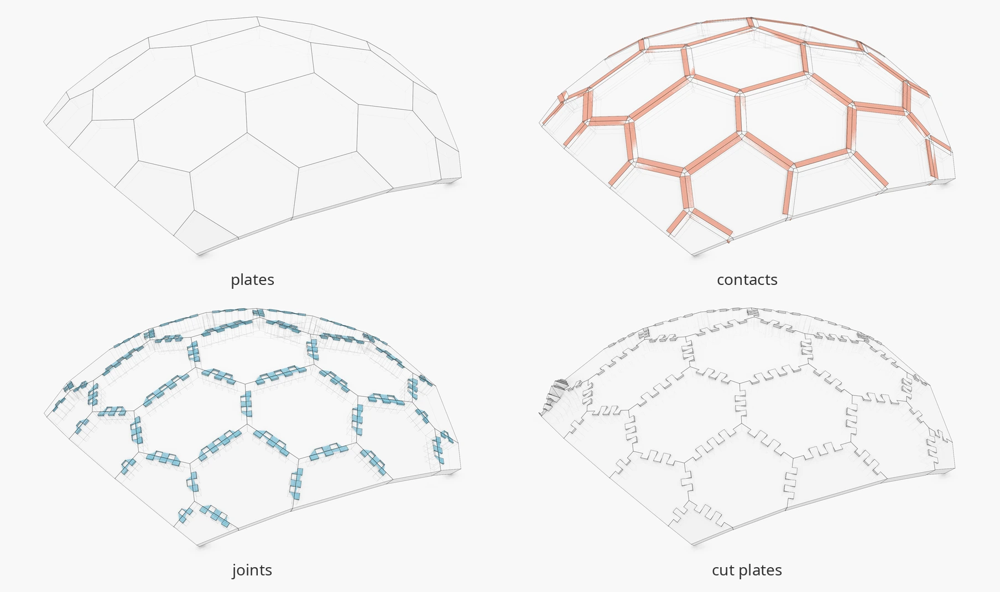
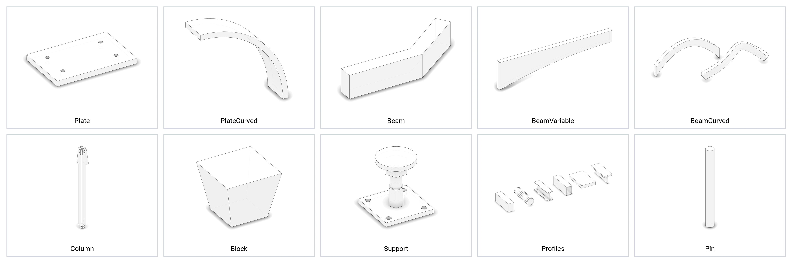
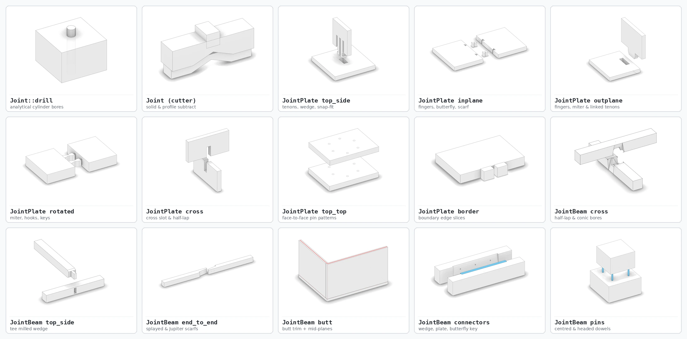

# Wood

Timber joinery solver and parametric structure templates built on [`session_cpp`](https://github.com/petrasvestartas/session_cpp).

**Documentation:** [https://petrasvestartas.github.io/wood/](https://petrasvestartas.github.io/wood/)



## Quick Start

```bash
cmake -S . -B build -DCMAKE_BUILD_TYPE=Release
cmake --build build --target run_tests --parallel
./build/run_tests
```

Every example writes a `.pb` scene to `data/output/pb/live.pb` for `session_viewer`:

```bash
cmake --build build --target element_joint_plate_side_side_outplane_fingers --parallel
./build/element_joint_plate_side_side_outplane_fingers
```

## Architecture

| Layer | Headers | Purpose |
| --- | --- | --- |
| Session | `src/joinery_solver/wood_session.h` | `WoodSession`: element storage, tree groups, contact queries, interaction graph, `.pb` export |
| Elements | `src/joinery_solver/wood_elements/*.h` | `Plate`, `PlateCurved`, `Beam`, `BeamVariable`, `Column`, `Block`, `Pin`, `Support`, `CutPlane`, `Profile`, `Joint`, `JointPlate`, `JointBeam` |
| Interactions | `src/joinery_solver/wood_interactions/*.h` | Contacts (`Face`, `Cross`, `Axis`) and cutting features (`Plane`, `Profile`, `Solid`, `Joint`) |
| Templates | `src/templates/*` | `Shells`, `Folding`, `CylindricalFolding`, `DevelopableFolding`, `Chevron`, `Cross`, `Reciprocal`, `Module`, `Grid`, `Truss`, `Floor` |





## Types

| Class | Stock Input | Primary Cutters |
| --- | --- | --- |
| `Plate` | `bottom`, `top` planar polylines | Outline slots and tenons (`JointPlate`), `CutPlane`, `Profile`, `Solid`, `Joint::drill` |
| `PlateCurved` | `outer_a`, `outer_b`, `inner_a`, `inner_b` (`NurbsCurve`) | Ruled side miters, planar caps, `Development` flat cutting outline |
| `Beam` | `axis` (`Line`), `profile` (`Polyline`), `z` (`Vector`) | `CutPlane`, `Profile`, `Solid`, `JointBeam`, `Joint::drill` |
| `BeamVariable` | `axis`, `profiles` at `stations` | Parabolic soffit ribs, `CutPlane`, `Solid`, `JointBeam` |
| `Column` | `Column::square(axis, frame, width)` | `head_blocks` (`SolidOperation::add`), `column_cutters` (`subtract`), `Joint::support` |
| `Support` | `Support(plane)` | Steel base plate, head plate, 3 anchor pins |
| `Block` / `Pin` | `Mesh` / `(head, direction, radius, length)` | Child solids nested under `Column` or `JointBeam` connectors |
| `CutPlane` / `Profile` | `Plane` / `(Plane, loops)` | Half-space clip (`InteractionFeaturePlane`) / 2D loop slot or pocket (`InteractionFeatureProfile`) |
| `Joint` | `Joint::drill`, `Joint::support` | Analytical NURBS cylinder bores (`BRep`) and 16-gon mesh drills |
| `JointPlate` | 38 presets across 7 families in unit box `[-0.5, 0.5]^3` | `orient(contact, elements)` → `interaction(target)` |
| `JointBeam` | `from_contact`, `butt`, `wedge`, `rectangle_plate`, `butterfly_key`, `centred_pins`, `headed_pins` | Axis contact joinery, automatic butt planes, and face-contact connectors |

## Datasets

`WoodData` (`src/wood_data.h`) loads XML polyline pairs (`datasets/*.xml`) and JSON meshes (`datasets/meshes/*.json`):

| Dataset | Count | Content |
| --- | --- | --- |
| `wood_data::ELEMENT_BEAM_POLYLINES` | 1 | Vidy beam pair |
| `wood_data::TYPE_1_30_POLYLINES` | 7 | Canonical joint-type plate pairs (`1`..`30`) |
| `wood_data::CASE_0_23_POLYLINES` | 26 | Plate contact test cases (`0`..`23`) |
| `wood_data::SHELLS_POLYLINES` | 13 | Pavilion shells (Brussels, Toshima, Kobra, Vidy, Annen, sequential) |
| `wood_data::MESH_*` | 7 | Input meshes for `Folding` (`annex`, `bridge`, `classroom`, `dome`, `hypar`, `sphere`, `vidy_chapel`) |

## Targets

| Group | CMake Targets |
| --- | --- |
| Tests & Docs | `run_tests`, `docs` (`cmake --build build --target docs`) |
| Elements | `element_plate`, `element_plate_curved`, `element_beam`, `element_beam_variable`, `element_block`, `element_column`, `element_cut_plane`, `element_profile`, `element_support`, `element_pin`, `element_joint` |
| Plate Joints | `element_joint_plate_side_side_outplane_*` (10), `element_joint_plate_side_side_inplane_*` (7), `element_joint_plate_side_side_rotated_*` (5), `element_joint_plate_top_side_*` (4), `element_joint_plate_cross_*` (2), `element_joint_plate_top_top_*` (7), `element_joint_plate_border_fingers`, `element_joint_plate_vidy_node` |
| Beam Joints | `element_joint_beam_cross_*` (5), `element_joint_beam_end_to_end_*` (2), `element_joint_beam_corner_*` (6), `element_joint_beam_top_side_*` (4), `element_joint_beam_butt_*` (5), `element_joint_beam_wedge`, `element_joint_beam_rectangle_plate`, `element_joint_beam_butterfly_key`, `element_joint_beam_centred_pins`, `element_joint_beam_headed_pins` |
| Cutting Gallery | `15_profile_cuts`, `16_drill_solids`, `17_solid_features`, `18_cutting_gallery`, `19_plate_joint_library` |
| Templates | `templates_shells_{1..4}_*`, `templates_folding_{1..16}_*`, `templates_cylindrical_folding_{1..17}_*`, `templates_developable_folding_{1..12}_*`, `templates_chevron_{1..2}_*`, `templates_cross_{1..2}_*`, `templates_reciprocal_{1..2}_*`, `templates_module_{1..9}_*`, `templates_grid_{1..4}_*`, `templates_truss`, `templates_floor_{1..8}_*` |
