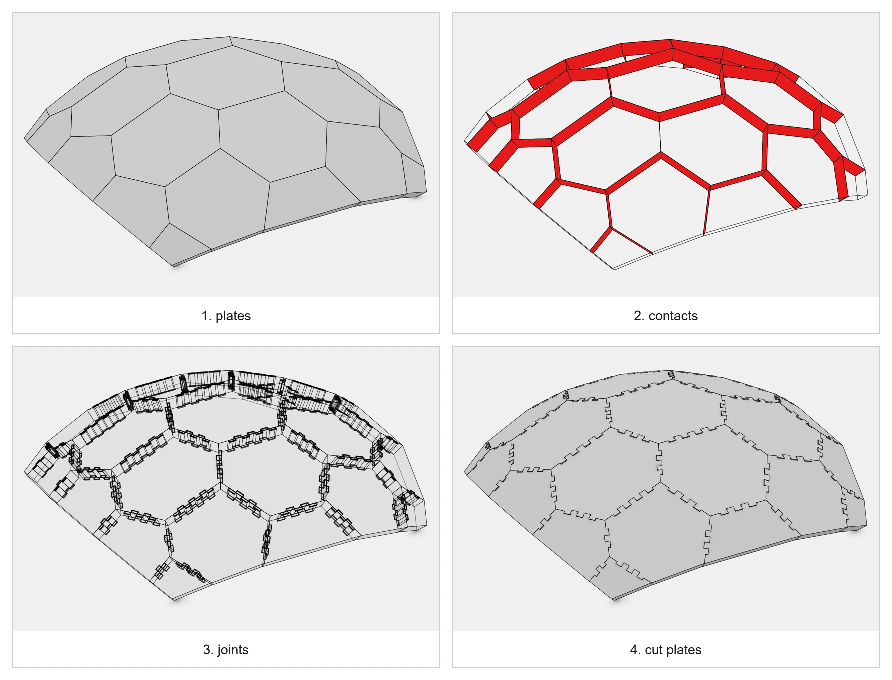

# Wood

Wood is a timber joinery solver: the members are given, it finds where they touch and cuts the joints. It comes from the doctoral thesis [Design-to-Fabrication Workflow for Raw-Sawn-Timber using Joinery Solver](https://infoscience.epfl.ch/record/288650) (EPFL, 2021) and is a C++ library on the [`session_cpp`](https://github.com/petrasvestartas/session_cpp) kernel.



## Build and run

```bash
git clone https://github.com/petrasvestartas/wood.git
cd wood
cmake -S . -B build -DCMAKE_BUILD_TYPE=Release
cmake --build build --target two_plates --parallel 6
./build/two_plates
```

On Windows with Visual Studio the program is `build\Release\two_plates.exe`. It writes `data/output/pb/live.pb`, which `session_viewer` opens.

## Documentation

[Overview](https://petrasvestartas.github.io/wood/) · [Architecture](https://petrasvestartas.github.io/wood/architecture.html) · [Elements](https://petrasvestartas.github.io/wood/elements.html) · [Templates](https://petrasvestartas.github.io/wood/templates.html) · [Examples](https://petrasvestartas.github.io/wood/examples.html) · [Setup](SETUP.md)

Run all tests with `cmake --build build --target run_tests`. Build these pages with `cmake --build build --target docs`.
