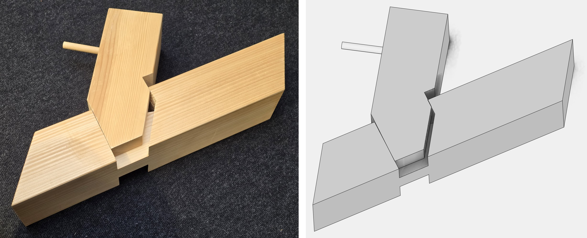
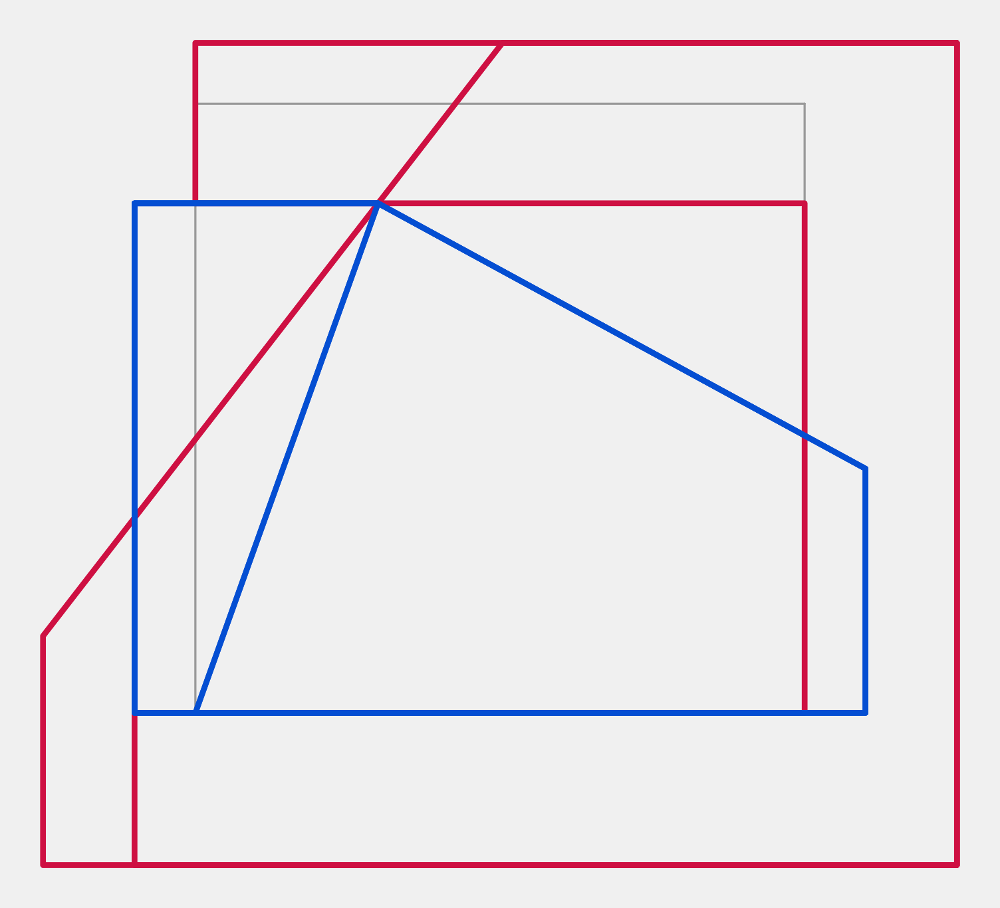
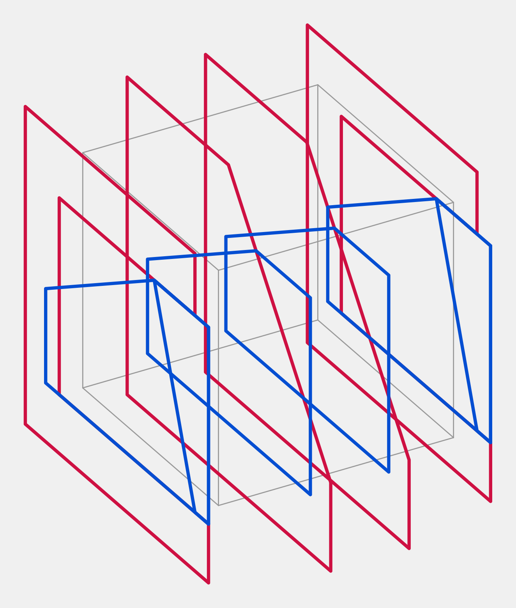

# A joint rebuilt from eight photos

Eight phone photos of one timber joint, no scale, no drawing. The result is `top_side_bridle`, a skew T-bridle in the joint library, applied to two beams. The full record, mistakes included, is [the log](../joint_from_photos_log.md).

## How it was done

There was no reconstruction system. It was reading, measuring by hand, and writing geometry.

1. **Looked at the photos.** Claude Opus 5.5 read each photo as an image and worked out what the object is: which piece is which, what is cut away, how it assembles. This is the only AI model in the job, and it is the one writing this file.
2. **Looked closer.** Crops at 2x to 3x corrected that first reading. Two of its statements were wrong: the tongue is not a full layer, and the slot does not stop on the first beam's side.
3. **Measured.** Grid lines were drawn over crops, and the corners were read off the grid by eye, 65 points across three photos, typed in by hand. Vanishing points from those corners gave the crossing angle and the proportions: 56.8 degrees, shoulder 0.30 of the width, thirds through the height. Scale is assumed: 100 mm section.
4. **Wrote the tile by hand** as outlines in the library's unit box, and built it.
5. **Checked it.** With the 3D corners of the model and the same hand-read image corners, OpenCV solved one camera per photo and gave the distance from each projected corner to the photo: mean 2.0 mm and 1.9 mm on the first beam, 1.7 mm on the second. The solved cameras also gave the directions for the viewer shots.
6. **Tested it.** Booleans on the real solids: no overlap seated, free along the slide, blocked every other way, at five angles.

**The model was not fitted to the images.** Only the cameras were solved. The geometry came from steps 1 to 4, and the photos were then used to check it.

## What was not used

No photogrammetry, no structure from motion, no depth estimation, no segmentation, no edge or feature detection, no NeRF or Gaussian splatting, no image-to-3D model, no third-party reconstruction service. No images left this machine for anything except being read by the model in this session. The only "AI" part is step 1 and the reasoning after it. Everything else is ordinary code.

## Tools

| what | used for |
|---|---|
| Claude Opus 5.5 reading images | seeing the object, every design decision, all the code |
| Python, OpenCV 4.13 | `imread`, crops, grid lines and an overlay; `solvePnP` (SQPNP, then iterative), `projectPoints`, `Rodrigues` to solve and check cameras |
| NumPy 2.5 | vanishing points by cross products, the rectification, residuals |
| Pillow 12.1 | the comparison sheets: crop and scale only |
| C++, CMake, MSVC, `wood`, `session_cpp` | the tile, the beams, the example, the test |
| Manifold, through wood's `solid_boolean` | the cuts and the overlap measurements |
| Node, Chrome, the hosted session viewer, `tools/screenshot_viewer.mjs`, `tools/crop_viewer_shot.py` | every grey picture here, real viewer screenshots |

The small scripts are throwaway ones in the session's scratch folder and are not in the repo.

## The tile

`JointPlate::top_side_bridle(shoulder = 0.3, tongue = 1.0 / 3.0)`, id 26, in [`top_side_bridle.h`](../../../src/joinery_solver/wood_interaction/wood_interaction_feature/wood_interaction_feature_plate_joints/top_side_bridle.h). As in every plate tile, male and female are outlines in a unit box, lofted in pairs. Here each pair is one milled cutter, `FabricationType::mill`.

The box is the joint volume: **x** through the height, **y** across the first beam from its near face (-0.5) to its far face (+0.5), **z** along it. Looking down x at 57 degrees, the grey square is the box, y to the right, z up:

- **Blue, female, cut from the first beam:** the pentagon, one pocket above and one below the tongue, and the sawn triangle through the height.
- **Red, male, cut from the second beam:** the outer shape taken from the whole height, and the slot, right of the diagonal line.
- Cutters run past the box so that booleans are clean. The picture crops them at 0.75; the slot's true line carries on.

The box itself does not carry the angle, so the tile reads the lean `c` from the male plate. For `c = cos(57 deg) = 0.545` and shoulder `s = 0.3`, with `a` the box length over its width (1.19), in unit `(y, z)`:

| point | y | z | value |
|---|---|---|---|
| near end of the shoulder wall | -0.5 | 0.5 - c s | (-0.5, 0.337) |
| pocket corner | s - 0.5 | 0.5 - c s | (-0.2, 0.337) |
| far end of the slanted wall | 0.5 | 0.5 - c | (0.5, -0.045) |
| far end of the square wall | 0.5 | -0.5 | (0.5, -0.5) |
| near end of the square wall | -0.5 | -0.5 | (-0.5, -0.5) |

- Layers: tongue `|x| <= tongue / 2`, pockets from there to `+-0.5`.
- Slot bottom: through the pocket corner, square to the second beam, `y = (s - 0.5) + c a a (z - (0.5 - c s))`.
- Saw cut through the tongue: from the pocket corner to the near end of the square wall, or to the slot's line where that lies further in, as it does near 90 degrees.

## How far to trust it

- The joint matches the photos closely, see [P8](compare_p8_apart.jpg), [P1](compare_p1_assembled_top.jpg), [the fork](compare_p3_fork.jpg) and [the tongue](compare_p4_tongue_face.jpg). Overlays of the model on the photos: [P8](overlay_p8.jpg), [P7](overlay_p7.jpg).
- All millimetres rest on the assumed 100 mm section. The residuals are only as good as the corners read by eye, about 1 percent.
- The focal length was left free and came out at 4600 to 5000 px, not the 2890 px I assumed when measuring P1. P1 is nearly top-down so that assumption barely mattered there, but it was a guess and it was off.
- Not modelled: the round plug in the tongue, read as a repair in the timber because the saw runs through it. That is a judgement, not a measurement.
- The stub pin was not part of the joint: the user says it is only a handle, so it was removed from the example.
- The first build was not flawless. The second beam came out 100 mm too long, and the tile was wrong near 90 degrees. Both were fixed, and both are in the log.
