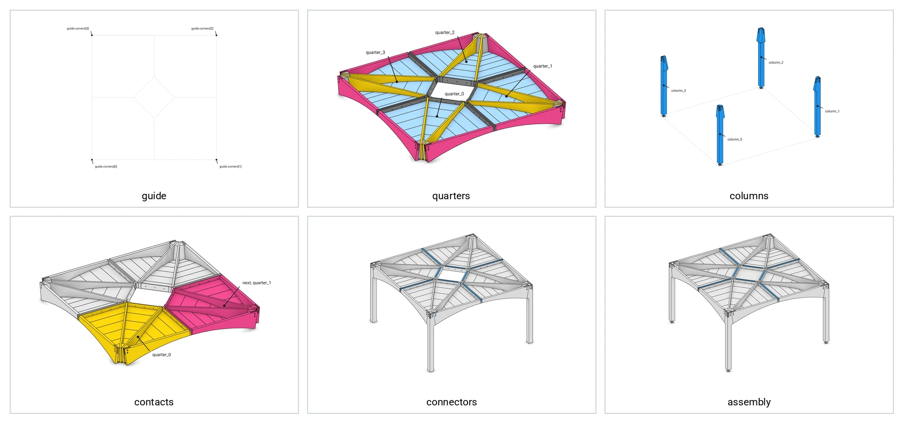

# Vaulted Timber Floor System (wood_floor::Floor) {#templates_floor}

- \subpage templates_floor_guide
- \subpage templates_floor_model



`wood_floor::FloorGuide` and `wood_floor::Floor` generate a four-quarter vaulted timber floor bay supported on four columns around a central pinwheel oculus. `FloorGuide` computes the construction planes, parabolic rib soffits, ruled central panels, bed plates, column blocks, seam/oculus beams, and column-head cutters from four plan corners; `Floor` turns those loops into `Plate`, `Beam`, `Joint`, `JointBeam`, and `Pin` elements inside `WoodSession`.

| Stage | Class / Method | Role |
| :--- | :--- | :--- |
| **1. FloorGuide** | `wood_floor::FloorGuide(corners, ...)` | Computes oculus points, construction planes, rib-start offsets, boundary parabolas, ruled central panel traces, bed rails/plates, wedges, beams, oculus ring, and column cutters. |
| **2. Quarters & Oculus** | `Floor::add_quarter_elements`, `add_oculus_elements` | Populates `WoodSession` with `outer_ribs`, `inner_ribs`, `wedges`, `tsections`, `beds`, `inner_beams`, and the 9 `oculus` pinwheel plates. |
| **3. Columns** | `Floor::add_column_elements` | Builds the 4 corner column shafts (`column_<q>`), ground `Support` pads (`support_<q>`), and 6 carving cutters (`column_cutter_<q>_<i>`) per column head. |
| **4. Face Contacts** | `Floor::add_contacts` | Intersects adjacent member pairs across all 4 quarters, seams, and the oculus to create planar `Joint` contact faces (`cantilever_*`, `pins_*`). |
| **5. Connectors & Pins** | `Floor::compute_connectors`, `add_connectors` | Generates `JointBeam::cantilever` wedges (`55°` / `65°`), let-in steel plates (`8 mm`), and `JointBeam::headed_pins` dowels (`Ø4 × 200 mm`), subtracting their housings and bores from the timber members. |
| **6. Exact BRep Output** | `session.pb_dump(...)` → `compute_breps()` | Boolean-subtracts all cuts, mortises, and cylindrical pin holes into exact `BRep` solids. |

---

## Primary Inputs (wood_floor::FloorGuide)

| Parameter | Default | Description |
| :--- | :--- | :--- |
| `corners` | `std::array<Point, 4>` | Four convex bay corners counter-clockwise at `z = 0` (e.g. `6000 × 6000 mm` square or `6000 × 4800 mm` rectangle). |
| `size_oculus` | `1000.0 mm` | Distance from the bay center to each of the 4 oculus points along the seam lines. |
| `size_column_head`, `size_column_head_chamfer` | `220.0 mm`, `120.0 mm` | Column shaft width and corner chamfer offset defining the 5-sided column head fan polygon. |
| `size_outer_ribs`, `size_inner_ribs`, `size_inner_beams` | `100.0 mm`, `60.0 mm`, `60.0 mm` | Thicknesses of the perimeter outer ribs, diagonal inner ribs, and seam/oculus beams. |
| `size_wedge`, `size_tsections` | `240.0 mm`, `27.0 mm` | Starting thickness of the side column blocks and thickness of the rib flange t-sections and bed layers. |
| `height`, `rise` | `650.0 mm`, `453.0 mm` | Rib depth at the column head fan plane (`650 mm`) and parabolic rise toward the seam (`static_h = height - rise = 197 mm`). |
| `wedge_plane_angle`, `oculus_plane_angle` | `-10.0°`, `5.0°` | Tilt angles of the middle column-head fan plane and the oculus bearing plane. |
| `column_head_depth`, `bay_height` | `730.0 mm`, `3500.0 mm` | Carved column head depth and total storey elevation above the ground support. |

---

## Quick Start

Constructing a `FloorGuide` from four plan corners in the `XY` plane (`z = 0`) and building the complete floor assembly in `WoodSession`:

```cpp
#include "wood.h"
#include "templates/floor/floor.h"

using namespace session_cpp;
using namespace wood_floor;

// 1. Compute all vaulted floor geometry for a 6000 x 6000 mm bay
FloorGuide guide({
    Point(-3000.0, -3000.0, 0.0),
    Point( 3000.0, -3000.0, 0.0),
    Point( 3000.0,  3000.0, 0.0),
    Point(-3000.0,  3000.0, 0.0),
});

// 2. Populate WoodSession with members, columns, contacts, cantilevers, and pins
WoodSession session;
Floor floor(guide, session);

// 3. Export exact BReps and scene graph to protobuf
session.pb_dump("floor_complete.pb");
```


---

## Complete Examples

### 1. Parametric FloorGuide Wireframe & Outlines (examples/templates_floor_1_floorguide.cpp)

<details>
<summary>Example code: templates_floor_1_floorguide.cpp</summary>

\include{lineno} templates_floor_1_floorguide.cpp

</details>

### 2. Single Column Head Carving & Capitel Connectors (examples/templates_floor_2_column_model.cpp)

<details>
<summary>Example code: templates_floor_2_column_model.cpp</summary>

\include{lineno} templates_floor_2_column_model.cpp

</details>

### 3. Member Contacts Across the Four Quarters (examples/templates_floor_3_contacts.cpp)

<details>
<summary>Example code: templates_floor_3_contacts.cpp</summary>

\include{lineno} templates_floor_3_contacts.cpp

</details>

### 4. Cantilever Wedge & Let-In Plate Connectors (examples/templates_floor_7_contacts_cantilevers.cpp)

<details>
<summary>Example code: templates_floor_7_contacts_cantilevers.cpp</summary>

\include{lineno} templates_floor_7_contacts_cantilevers.cpp

</details>

### 5. Rectangular Bay Adaptation (examples/templates_floor_8_rectangle.cpp)

<details>
<summary>Example code: templates_floor_8_rectangle.cpp</summary>

\include{lineno} templates_floor_8_rectangle.cpp

</details>

### 6. Fabrication Branch & Ground Orientation (examples/templates_floor_9_orientation.cpp)

<details>
<summary>Example code: templates_floor_9_orientation.cpp</summary>

\include{lineno} templates_floor_9_orientation.cpp

</details>
