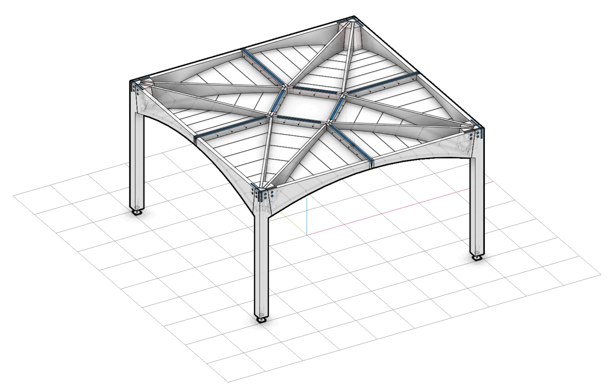

# Floor {#templates_floor}

[TOC]

Vaulted timber floor slab supported on four carved-head columns (`src/templates/floor/floor_guide.h`, `src/templates/floor/floor.h`). `wood_floor::FloorGuide` and `wood_floor::Floor` transform four counter-clockwise bay corner `Point`s into four radial rib-and-bed quarters interlocked around a central oculus ring (`68` face contacts, wedges, let-in column plates, centred dowels, and `56` headed assembly pins).

- @subpage templates_floor_guide — `wood_floor::FloorGuide` (`src/templates/floor/floor_guide.h`): Steps 1–6 (bay split, radial fan planes, datum loops, parabolic soffits, bed rails, column cutters)
- @subpage templates_floor_model — `wood_floor::Floor` (`src/templates/floor/floor.h`): Steps 7–11 (timber members, carved columns & supports, `68` face contacts, connectors, pins, exact `BRep` export)

---

## Primary Inputs (`wood_floor::FloorGuide`)

| Primary Input / Field | Default | Geometric Role |
| --- | --- | --- |
| `corners` | `std::array<Point, 4>` | Four bay corners in counter-clockwise order (e.g. `(-3000, -3000, 0)` to `(-3000, 3000, 0)` for a `6000 × 6000 mm` square bay, or `±3000 × ±2400 mm` for a rectangular bay) |
| `floor_elevation`, `floor_thickness` | `3500.0`, `140.0` | Top datum $z$ of the slab (`mm`) and structural thickness at the oculus/outer ring |
| `column_width`, `head_widen`, `head_height` | `220.0`, `120.0`, `730.0` | `220 × 220 mm` column shaft widened by `120 mm` on the two bay faces over the top `730 mm` (`head_blocks`) |
| `oculus_side`, `ring_width` | `1414.21`, `200.0` | Central diamond oculus side length (`half-diagonal = 1000 mm`) and ring beam width |
| `outer_rib_width`, `inner_rib_width`, `seam_beam_width` | `200.0`, `120.0`, `120.0` | Plan widths (`mm`) of the radial outer ribs, inner ribs, and quarter-seam beams |
| `tsection_thickness`, `bed_thickness`, `bed_layers` | `27.0`, `27.0`, `3` | Lamella thickness (`27 mm`) of the lower T-section flanges and the `3` stepped parabolic bed layers |

---

## Full C++ Examples

| Example File | Scene & Construction Stage Demonstrated |
| --- | --- |
| `templates_floor_1_floorguide.cpp` | `FloorGuide`: quarter `0` plan, member quads, fan planes, and parabolic soffit curves (Steps 1–6) |
| `templates_floor_2_column_model.cpp` | Single corner column (`column_0`) on its Sherpa `Support`, glued `head_blocks`, and 6-cutter carved head |
| `templates_floor_3_contacts.cpp` | `68` `InteractionContactFace` regions (`17` per quarter) visualized in X-ray mode |
| `templates_floor_7_contacts_cantilevers.cpp` | Complete `6000 × 6000 mm` square bay with columns, wedges, column plates, pins, and exact NURBS `BRep` bores |
| `templates_floor_8_rectangle.cpp` | Complete `6000 × 4800 mm` rectangular bay (`HALF_X = 3000`, `HALF_Y = 2400`) |
| `templates_floor_9_orientation.cpp` | Extracting `column_0` into a fabrication session and reorienting it flat onto the $XY$ ground plane via `Xform::plane_to_plane` |

### 1. Quarter 0 Geometric Guide (`examples/templates_floor_1_floorguide.cpp`)

\include{lineno} templates_floor_1_floorguide.cpp

### 2. Single Carved Column & Support (`examples/templates_floor_2_column_model.cpp`)

\include{lineno} templates_floor_2_column_model.cpp

### 3. The 68 Face Contacts (`examples/templates_floor_3_contacts.cpp`)

\include{lineno} templates_floor_3_contacts.cpp

### 4. Complete Square Bay with Connectors & Pins (`examples/templates_floor_7_contacts_cantilevers.cpp`)

\include{lineno} templates_floor_7_contacts_cantilevers.cpp

### 5. Rectangular Bay (`examples/templates_floor_8_rectangle.cpp`)

\include{lineno} templates_floor_8_rectangle.cpp

### 6. Fabrication Ground Reorientation (`examples/templates_floor_9_orientation.cpp`)

\include{lineno} templates_floor_9_orientation.cpp
