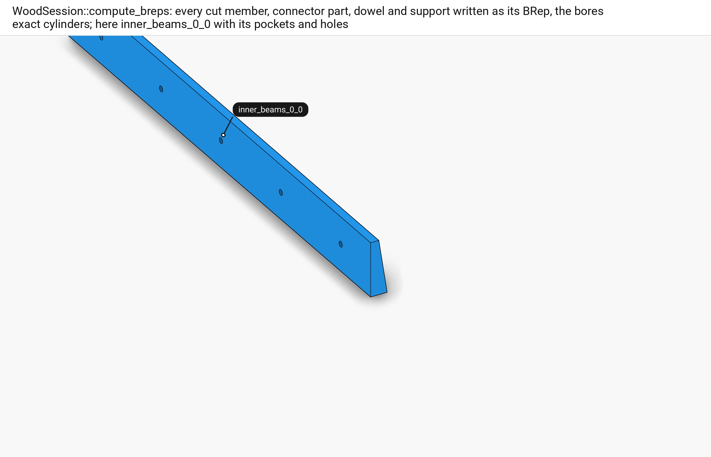
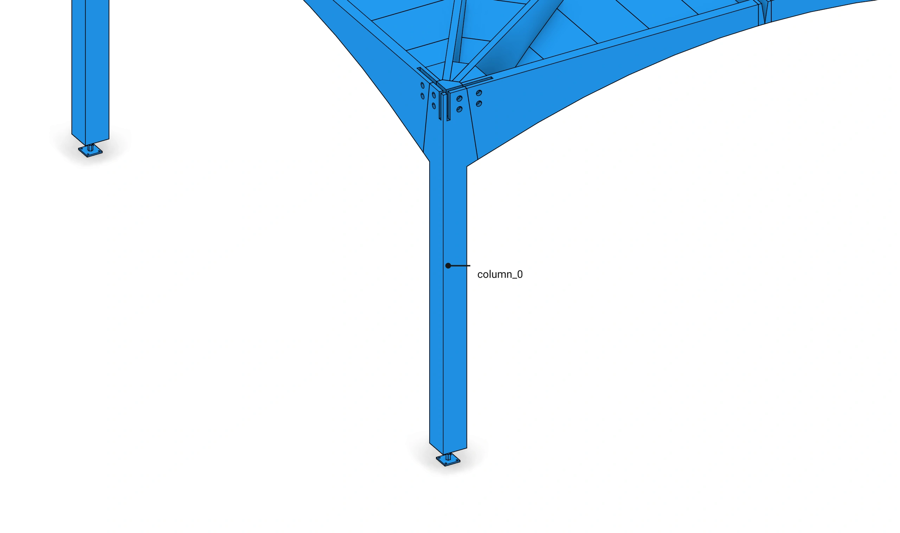
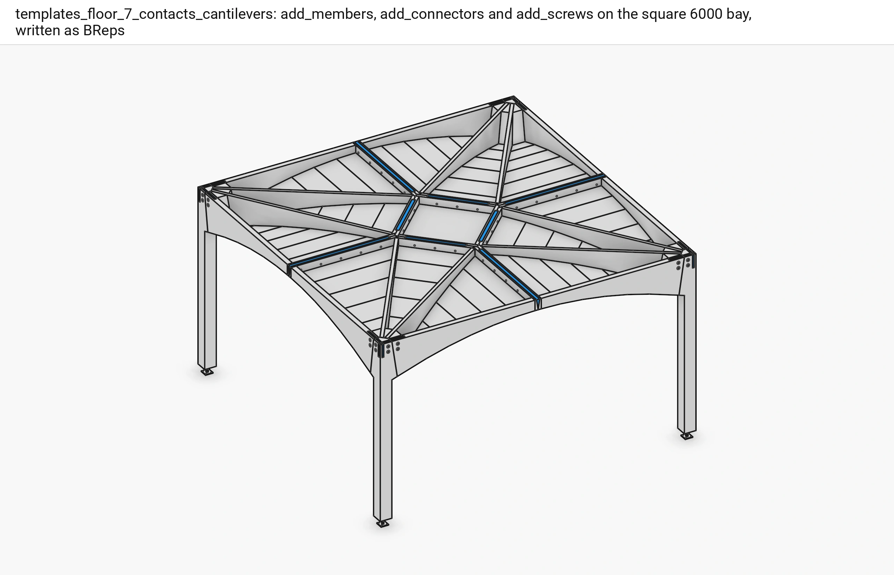
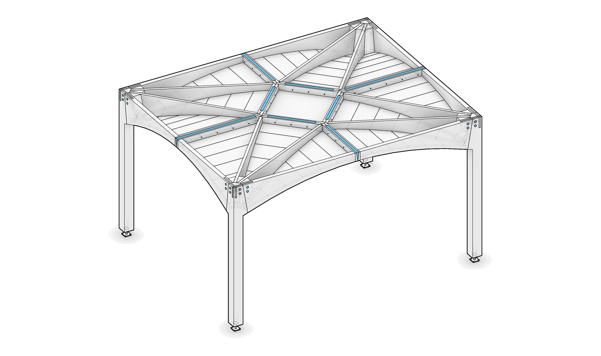

# Floor 11: BReps and the examples {#templates_floor_11_examples}

[TOC]

<em>Step 11 of @ref templates_floor_model · previous: @ref templates_floor_10_pins</em>

`WoodSession::pb_dump` invokes `compute_breps()` so every cut member, wedge, let-in plate, and cylindrical pin bore is serialized as an exact `BRep` solid.

## 351. compute_breps

■ built `inner_beams_0_0` as a BRep

`WoodSession::compute_breps` is called first by `pb_dump` (through `pb_dumps`).
It writes every cut member, connector part, pin and support as its BRep instead of its mesh, the bores exact cylinders.
Here the seam beam shows its pin holes.

Code: `WoodSession::compute_breps`, `WoodSession::pb_dumps`, [wood_session.cpp](https://github.com/petrasvestartas/wood/blob/main/src/joinery_solver/wood_session.cpp).

## 352. Example: one column (templates_floor_2_column_model.cpp)

■ built `column_0` and `support_0`

Example code: templates_floor_2_column_model.cpp

\include{lineno} templates_floor_2_column_model.cpp

## 353. Example: the square floor (templates_floor_7_contacts_cantilevers.cpp)

■ built the connector parts   ■ context the members, cut

Example code: templates_floor_7_contacts_cantilevers.cpp

\include{lineno} templates_floor_7_contacts_cantilevers.cpp

## 354. Example: a rectangular bay (templates_floor_8_rectangle.cpp)

■ built the connector parts   ■ context the members, cut

Example code: templates_floor_8_rectangle.cpp

\include{lineno} templates_floor_8_rectangle.cpp

