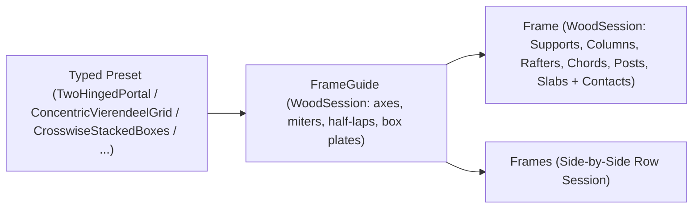

# Frame {#templates_frame}

[TOC]

Section-active portal, tiered, multi-panel Vierendeel, and cellular slab box-frame (`Plattenrahmen`) generator: the inputs and 16 structural presets in `src/templates/frame/frame_guide.h`, the builders `Frame` and `Frames` in `src/templates/frame/frame.h`. Built on the `WoodSession` guide-and-model pattern, `wood_frame::FrameGuide` computes exact knee miters, crown hinges, sloped half-lap Gerber seats, shear-gradated Vierendeel chords/posts, and cellular CLT box tubes, while `wood_frame::Frame` materializes non-overlapping timber elements, face contacts, and bottom-up `ModuleSequence` assemblies.

  <a class="wood-card" href="#frame_example_1">
    
    1 Portal &amp; Gable Frames
  </a>
  <a class="wood-card" href="#frame_example_2">
    
    2 Coupled &amp; Tiered Frames
  </a>
  <a class="wood-card" href="#frame_example_3">
    
    3 Vierendeel Frames
  </a>
  <a class="wood-card" href="#frame_example_4">
    
    4 Slab Box Frames
  </a>
  <a class="wood-card" href="#frame_assembly_sequence">
    
    Assembly Sequence
  </a>

---

## Code Structure {#frame_architecture}

1. **`FrameGuide`** (`src/templates/frame/frame_guide.h`) computes all geometric construction tables from typed parameter structs:
   - **Exact portal &amp; gable knee miters**: intersects the tapered leg's inner cheek line with the flat or pitched rafter's haunched soffit line so both `EdgeVariableElement` solids share one coplanar diagonal miter quad (`0.000 mm³` clash) whose normal points upward-inward (`+Z > 0`), allowing every rafter to lower straight down like a keystone.
   - **Articulated T-frame &amp; three-hinged joints**: builds vertical ridge/corridor crown hinges (`Dreigelenkrahmen`) and sloped complementary half-lap seats (`InteractionFeatureSolid`) where outer L-frame rafters bear on double-cantilever `T-Rahmen` crossheads.
   - **Multi-panel Vierendeel &amp; cellular box-frame (`Plattenrahmen`) tables**: generates continuous chords (`chord_bottom`, `chord_top`), shear-gradated vertical posts (`post`), biaxial `#`-grid intersections, and tubular `FacePlanarElement` box cells (`slab_bottom`, perforated `wall` piers, skylit `slab_top`).
2. **`Frame` &amp; `Frames`** (`src/templates/frame/frame.h`) populate `NodeSupportElement`, `EdgeStraightElement`, `EdgeVariableElement`, and `FacePlanarElement` solids, compute exact `InteractionContactFace` graphs, and record stage-ordered `AssemblyModule` sequences verified by `ModuleSequence`.

---

## Engel Section-Active Frame Taxonomy and Element Library {#frame_engel_taxonomy}

While @ref templates_grid covers planar beam layouts (§3.1), grillages (§3.3), and slab plates (§3.4), **`wood_frame`** realizes the spatial **frame-action systems** of Heino Engel (*Structure Systems / Tragsysteme*, Chapter 3, §§3.2 &amp; 3.4), where columns and horizontal beams or slabs act monolithically through moment-resisting knees to reduce midspan positive moments and resist lateral drift without diagonal bracing:

| Engel Frame Family | Structural Mechanics | Wood Elements &amp; Joinery Realization |
|---|---|---|
| **Two- &amp; Three-Hinged Portal Halls** (Engel §3.2, pp. 187–190) | Pinned bases (`M = 0`) eliminate foundation bending; bending moment peaks at the rigid knee (`M_k`) and drops toward base pins and optional crown hinge (`Dreigelenk`). | `NodeSupportElement` base pins, 2-station tapered `EdgeVariableElement` legs, exact coplanar knee miter `cuts`, haunched/pitched `EdgeVariableElement` rafters, and `EdgeStraightElement` roof purlins. |
| **Cantilevered, Doubled-Column &amp; Articulated T-Frames** (Engel §3.2, pp. 174, 188, 191) | Balanced overhangs and interior T-cantilevers shift inflection points inward, allowing shorter suspended/L-frame spans connected at zero-moment pins. | Symmetric double-cantilever `EdgeVariableElement` crossheads on centered tapered columns, paired with sloped half-lap `InteractionFeatureSolid` corbel seats (`ArticulatedTFrame`, `DoubledColumnCantilever`). |
| **Coupled Multi-Storey &amp; Tiered Clerestory Frames** (Engel §3.2, pp. 188, 192–193) | Coupled frames share horizontal thrust across corridor pins; tiered frames seat an upper two-hinged hall directly on the inward or outward cantilevers of lower frames. | Multi-stage `FrameGuide` assemblies (`CoupledTwoHinged`, `CoupledThreeHinged`, `TieredClerestoryHall`, `TieredOutwardHall`) with flush between-bent floor ties (`purlin`). |
| **Multi-Panel Vierendeel Frames** (Engel §3.2, pp. 194–199) | Quadrangular truss without diagonals: chords carry global axial couple + local panel shear bending; transverse shear peaks near supports and vanishes at midspan. | Continuous `EdgeStraightElement` chords + **column-width gradated posts** (`ColumnGradatedVierendeel`), **bay-width gradated posts** (`BayGradatedVierendeel`), open `#` biaxial grids (`ConcentricVierendeelGrid`), and crosswise stacks (`CrosswiseStackedVierendeel`). |
| **Cellular Slab Box Frames (`Plattenrahmen`)** (Engel §3.4, p. 209) | Extending uniaxial portal frame action into 3D planar plates: floor, ceiling, and side walls form rigid hollow rectangular tubes capable of dramatic two-way cantilevers. | `FacePlanarElement` bottom slabs, perforated side-wall shear piers, and skylit top slabs (`holes_bottom` / `holes_top`) arranged as open portals, pilotis grids, and crosswise-stacked tubes. |

---

<!-- assembly:begin -->
## Assembly Sequence {#frame_assembly_sequence}

Stage by stage from the foundation up: steel base shoes, tapered legs and central piers, haunched and pitched rafters down their knee miters and half-lap seats, Vierendeel bottom chords, shear posts and top chords, floor and roof purlins, and cellular box-frame bottom slabs, side walls and top slabs. Every move is a `ModuleSequence` move: the module taken apart piece by piece, each piece swept as a solid against every piece still in, the moving ones drawn brown, a GIF per kind of module and one of the whole.

| assembly | | |
|---|---|---|
| **Portal, gable and articulated T-frames**, 132 elements, 128 moves | | |
|  cantilever t frame, 45 pieces |  doubled column cantilever, 28 pieces |  three hinged gable, 32 pieces |
|  two hinged portal, 27 pieces |  |  |
| **Coupled and tiered hinged frames**, 309 elements, 305 moves | | |
|  coupled three hinged, 97 pieces |  coupled two hinged, 95 pieces |  tiered clerestory hall, 65 pieces |
|  tiered outward hall, 52 pieces |  |  |
| **Shear-gradated and concentric Vierendeel frames**, 292 elements, 288 moves | | |
|  bay gradated vierendeel, 44 pieces |  column gradated vierendeel, 74 pieces |  concentric vierendeel grid, 80 pieces |
|  crosswise stacked vierendeel, 94 pieces |  |  |
| **Cellular slab box frames**, 164 elements, 160 moves | | |
|  cantilevered multi box, 44 pieces |  closed pilotis box, 30 pieces |  crosswise stacked boxes, 60 pieces |
|  open box frames, 30 pieces |  |  |

<!-- assembly:end -->

## Examples {#frame_examples}

### 1 Hinged, Gable, Articulated T-Frame and Doubled-Column Portal Halls {#frame_example_1}

Four single-storey section-active portal halls after Engel (§3.2, pp. 174, 187–191): **(1)** a four-bent **two-hinged portal hall** (`Zweigelenkrahmen`) with `NodeSupportElement` base shoes, tapered legs, exact `45°` knee miters, and haunched rafters; **(2)** a pitched **three-hinged gable hall** (`Dreigelenk-Giebelrahmen`) tapering down to base pins and a central ridge crown hinge; **(3)** a two-bay **articulated T-frame hall** (`Gelenkrahmen mit T-Rahmen`, Engel p. 174-15) coupling outer L-frames onto the sloped half-lap corbel seats of a central double-cantilever T-frame; and **(4)** a wide-overhang hall on **doubled interior columns** carrying `7.6 m` symmetric tapered cantilevers (Engel p. 191-04).

  <a class="wood-card" href="templates_frame_1_portal_frames_two_hinged_portal.webp">
    
    Two-Hinged Portal
  </a>
  <a class="wood-card" href="templates_frame_1_portal_frames_three_hinged_gable.webp">
    
    Three-Hinged Gable
  </a>
  <a class="wood-card" href="templates_frame_1_portal_frames_cantilever_t_frame.webp">
    
    Articulated T-Frame
  </a>
  <a class="wood-card" href="templates_frame_1_portal_frames_doubled_column_cantilever.webp">
    
    Doubled-Column Cantilever
  </a>

\include{lineno} templates_frame_1_portal_frames.cpp

---

### 2 Multi-Storey Coupled and Tiered Hinged Frames {#frame_example_2}

Four multi-storey and stepped hall systems after Engel (§3.2, pp. 188, 192–193): **(1)** a three-storey **coupled two-hinged portal** building whose inward corridor cantilevers meet at central pins; **(2)** a three-storey stacked **three-hinged T-frame** building (`Dreigelenk-Stockwerkrahmen`); **(3)** a **tiered clerestory basilica hall** (Engel p. 193-03) where an upper two-hinged portal stands directly on the inward cantilevers of two lower side portals; and **(4)** a **tiered outward-cantilever hall** (Engel p. 193-05/06) where an upper wide portal stands on the outward cantilevers of a lower three-hinged portal.

  <a class="wood-card" href="templates_frame_2_tiered_frames_coupled_two_hinged.webp">
    
    Coupled Two-Hinged
  </a>
  <a class="wood-card" href="templates_frame_2_tiered_frames_coupled_three_hinged.webp">
    
    Stacked Three-Hinged
  </a>
  <a class="wood-card" href="templates_frame_2_tiered_frames_tiered_clerestory_hall.webp">
    
    Tiered Clerestory Hall
  </a>
  <a class="wood-card" href="templates_frame_2_tiered_frames_tiered_outward_hall.webp">
    
    Tiered Outward Hall
  </a>

\include{lineno} templates_frame_2_tiered_frames.cpp

---

### 3 Shear-Gradated, Concentric and Crosswise-Stacked Vierendeel Frames {#frame_example_3}

Four open multi-panel Vierendeel systems after Engel (§3.2, pp. 194–199): **(1)** a seven-panel Vierendeel hall with **column-width shear gradation** (`560 mm` end posts down to `220 mm` midspan posts, Engel p. 195-07); **(2)** a double-cantilevered eight-panel Vierendeel bridge on central tapered piers with **bay-width shear gradation** (Engel p. 195-10); **(3)** an open biaxial **`#`-concentric Vierendeel space grid** spanning a `24 x 24 m` column-free hall on eight perimeter fin columns (Engel p. 197-01 top); and **(4)** three storeys of open six-panel Vierendeel frames **stacked crosswise** with two-way cantilevers (Engel p. 197-01 bottom).

  <a class="wood-card" href="templates_frame_3_vierendeel_frames_column_gradated_vierendeel.webp">
    
    Post-Gradated Vierendeel
  </a>
  <a class="wood-card" href="templates_frame_3_vierendeel_frames_bay_gradated_vierendeel.webp">
    
    Bay-Gradated Vierendeel
  </a>
  <a class="wood-card" href="templates_frame_3_vierendeel_frames_concentric_vierendeel_grid.webp">
    
    Concentric Vierendeel Grid
  </a>
  <a class="wood-card" href="templates_frame_3_vierendeel_frames_crosswise_stacked_vierendeel.webp">
    
    Crosswise Vierendeel
  </a>

\include{lineno} templates_frame_3_vierendeel_frames.cpp

---

### 4 Cellular CLT Slab Box Frames (`Plattenrahmen`) {#frame_example_4}

Four spatial plate box-frame systems after Engel (§3.4, p. 209): **(1)** **open box-frame portals** (`Offene Plattenrahmen`) surmounted by a raised central cross-box; **(2)** an elevated cellular **closed box-frame grid on pilotis** (`Geschlossene Plattenrahmen`) with perforated side-wall piers and roof skylight cutouts; **(3)** **multi-storey cantilevered box frames** (`Mehrgeschoss-Plattenrahmen`); and **(4)** three upper levels of long tubular CLT box frames **stacked crosswise** (`Kreuzweise gestapelte Plattenrahmen`) over twin portal box piers.

  <a class="wood-card" href="templates_frame_4_box_frames_open_box_frames.webp">
    
    Open Box Frames
  </a>
  <a class="wood-card" href="templates_frame_4_box_frames_closed_pilotis_box.webp">
    
    Pilotis Box Grid
  </a>
  <a class="wood-card" href="templates_frame_4_box_frames_cantilevered_multi_box.webp">
    
    Multi-Storey Box Frames
  </a>
  <a class="wood-card" href="templates_frame_4_box_frames_crosswise_stacked_boxes.webp">
    
    Crosswise Box Frames
  </a>

\include{lineno} templates_frame_4_box_frames.cpp
