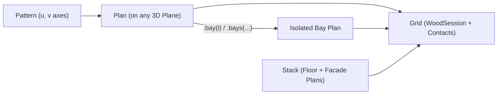

# Grid {#templates_grid}

[TOC]

Planar and multi-storey timber grid generator in `src/templates/grid/grid.h`. The primary unit is a single planar `wood_grid::Plan` embedded on any 3D `Plane`—a single floor, an isolated bay (`Plan::bay`), a sloped roof, or a vertical facade (`Plan::facade`)—framed by `wood_grid::Grid` and composed into multi-storey buildings by `wood_grid::Stack`.

<div class="wood-card-grid cols-4">
  <a class="wood-card" href="#grid_example_1">
    
    <span class="wood-card-title">1 Bay &amp; Framing</span>
  </a>
  <a class="wood-card" href="#grid_example_2">
    
    <span class="wood-card-title">2 Floor Footprints</span>
  </a>
  <a class="wood-card" href="#grid_example_3">
    
    <span class="wood-card-title">3 Facade Grids</span>
  </a>
  <a class="wood-card" href="#grid_example_4">
    
    <span class="wood-card-title">4 Multi-Storey Stack</span>
  </a>
</div>

---

## Architecture {#grid_architecture}



Instead of coupling every model to a horizontal multi-storey stack, `wood_grid` separates three clean layers:

1. **`Pattern`** generates 2D axis families in local `(u, v)` coordinates: `orthogonal` (including skewed grids), `radial` (concentric glulam rings around an optional oculus), `triangular` (`60°` diagrid), `hexagonal` (`120°` honeycomb), and `from_lines`.
2. **`Plan`** clips a `Pattern` against optional outer/opening boundary rings and core loops on any 3D `Plane`:
   - Horizontal `Plane` for a **single floor** (`Plan::from_pattern`, `Plan::from_footprint`).
   - Vertical or pitched `Plane` for a **timber facade** (`Plan::facade`, with window openings and gable silhouettes).
   - **`Plan::bay(i)` / `Plan::bays({...})`** isolates one bay or a subset of bays as its own standalone `Plan` without mesh triangulation diagonals.
3. **`Framing` & `Grid`** turn one `Plan` (or a multi-storey `Stack`) into non-overlapping timber `EdgeStraightElement`, `NodeBlockElement`, and `FacePlanarElement` solids with face-to-face contacts:
   - **Systems (`System`)**: `Slab` (point-supported CLT), `PostAndBeam` (girders and transverse/ring beams on grid axes), and `GirderPurlin` (`PurlinMode::Flush` or `PurlinMode::Stacked`).
   - **Column nodes (`NodeMode`)**: `Flush` (columns stop at framing soffit), `Through` (continuous columns with beams and decks trimmed to column faces), and `Head` (one clean chamfered timber head block beneath the slab or girders, clipped flush on perimeter/corner columns).
   - **In-plane bracing (`BraceMode`)**: `Diagonal`, `Cross` (co-planar split X-bracing), and `Chevron`, trimmed cleanly inside quadrilateral bays.

```cpp
const Plane floor_plane(Point(0.0, 0.0, 3600.0), Vector(1, 0, 0), Vector(0, 1, 0));
const wood_grid::Plan floor = wood_grid::Plan::from_footprint(
    {footprint}, wood_grid::Pattern::orthogonal({4000.0, 4000.0, 4000.0}, {4000.0, 4000.0}), {}, floor_plane
);

// Frame the entire floor, or isolate bay 0 alone:
wood_grid::Grid whole_floor(floor, framing, "floor");
wood_grid::Grid single_bay(floor.bay(0), framing, "bay_0");
```

---

## Examples {#grid_examples}

### 1 Bay Isolation and Timber Framing Modes {#grid_example_1}

Isolates bay `0` from a five-bay L-shaped floor plan via `Plan::bay(0)`, then compares pure-timber column, head, girder, purlin, and CLT deck configurations on a single bay (`0.000 mm³` pairwise overlap across all elements).

<div class="wood-card-grid cols-4">
  <a class="wood-card" href="templates_grid_1_bay_framing_floor_l_plan.webp">
    
    <span class="wood-card-title">L-Plan Floor</span>
  </a>
  <a class="wood-card" href="templates_grid_1_bay_framing_isolated_bay.webp">
    
    <span class="wood-card-title">Isolated Bay (bay(0))</span>
  </a>
  <a class="wood-card" href="templates_grid_1_bay_framing_slab_head.webp">
    
    <span class="wood-card-title">Slab + Chamfered Head</span>
  </a>
  <a class="wood-card" href="templates_grid_1_bay_framing_beam_head.webp">
    
    <span class="wood-card-title">Beams + Chamfered Head</span>
  </a>
  <a class="wood-card" href="templates_grid_1_bay_framing_node_flush.webp">
    
    <span class="wood-card-title">Flush Node &amp; Purlins</span>
  </a>
  <a class="wood-card" href="templates_grid_1_bay_framing_node_through.webp">
    
    <span class="wood-card-title">Through-Columns</span>
  </a>
  <a class="wood-card" href="templates_grid_1_bay_framing_purlin_stacked.webp">
    
    <span class="wood-card-title">Stacked Purlins</span>
  </a>
  <a class="wood-card" href="templates_grid_1_bay_framing_round_columns.webp">
    
    <span class="wood-card-title">Round Timber Columns</span>
  </a>
</div>

\include{lineno} templates_grid_1_bay_framing.cpp

---

### 2 Planar Floor Patterns and Footprints {#grid_example_2}

Frames single-floor footprints across seven planar grid patterns: orthogonal L-floor, `30°` skewed parallelogram, `12`-sector concentric glulam ring pavilion with an open central oculus and full ring beams, equilateral `60°` triangular diagrid, `120°` hexagonal honeycomb, five-sided irregular polygon with hand-drawn axes, and a courtyard floor plate.

<div class="wood-card-grid cols-4">
  <a class="wood-card" href="templates_grid_2_footprints_orthogonal.webp">
    
    <span class="wood-card-title">Orthogonal</span>
  </a>
  <a class="wood-card" href="templates_grid_2_footprints_skewed.webp">
    
    <span class="wood-card-title">Skewed (30°)</span>
  </a>
  <a class="wood-card" href="templates_grid_2_footprints_radial.webp">
    
    <span class="wood-card-title">Radial Ring</span>
  </a>
  <a class="wood-card" href="templates_grid_2_footprints_triangular.webp">
    
    <span class="wood-card-title">Triangular (60°)</span>
  </a>
  <a class="wood-card" href="templates_grid_2_footprints_hexagonal.webp">
    
    <span class="wood-card-title">Hexagonal (120°)</span>
  </a>
  <a class="wood-card" href="templates_grid_2_footprints_irregular.webp">
    
    <span class="wood-card-title">Irregular</span>
  </a>
  <a class="wood-card" href="templates_grid_2_footprints_courtyard.webp">
    
    <span class="wood-card-title">Courtyard</span>
  </a>
</div>

\include{lineno} templates_grid_2_footprints.cpp

---

### 3 Timber Facade Grids {#grid_example_3}

Uses `Plan::facade` (`post_height = 0.0`) to frame vertical timber curtain walls, punched window/spandrel facades (`deck_flush = true`), co-planar X-braced heavy-timber frames (`BraceMode::Cross`), and pitched pentagonal gable walls (`BraceMode::Chevron`).

<div class="wood-card-grid cols-4">
  <a class="wood-card" href="templates_grid_3_facades_curtain_mullion.webp">
    
    <span class="wood-card-title">Mullion &amp; Transom</span>
  </a>
  <a class="wood-card" href="templates_grid_3_facades_punched_openings.webp">
    
    <span class="wood-card-title">Punched Openings</span>
  </a>
  <a class="wood-card" href="templates_grid_3_facades_braced_facade.webp">
    
    <span class="wood-card-title">X-Braced Facade</span>
  </a>
  <a class="wood-card" href="templates_grid_3_facades_gable_facade.webp">
    
    <span class="wood-card-title">Gable Facade</span>
  </a>
</div>

\include{lineno} templates_grid_3_facades.cpp

---

### 4 Multi-Storey Composition {#grid_example_4}

Composes single-floor and facade `Plan`s across storeys with `wood_grid::Stack`: a two-storey L-shaped five-bay building with chamfered timber heads, a five-storey podium and setback tower (`Stack::from_levels`) with continuous through-columns and notched CLT floor plates, and a three-storey hybrid timber building with pinwheel CLT core walls and braced perimeter facades (`Stack::add_perimeter_facades`).

<div class="wood-card-grid cols-3">
  <a class="wood-card" href="templates_grid_4_multistorey_five_bay.webp">
    
    <span class="wood-card-title">Five-Bay L Frame</span>
  </a>
  <a class="wood-card" href="templates_grid_4_multistorey_setback_tower.webp">
    
    <span class="wood-card-title">Setback Tower</span>
  </a>
  <a class="wood-card" href="templates_grid_4_multistorey_core_and_facade.webp">
    
    <span class="wood-card-title">Core &amp; Braced Facades</span>
  </a>
</div>

\include{lineno} templates_grid_4_multistorey.cpp
