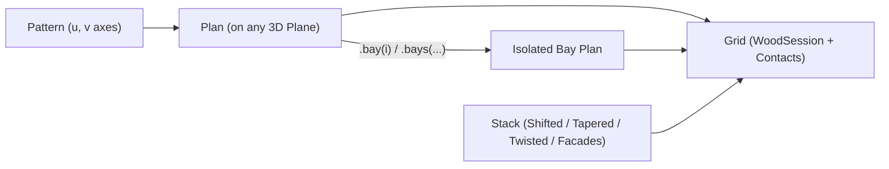

# Grid {#templates_grid}

[TOC]

Planar, facade, and multi-storey timber grid generator in `src/templates/grid/grid.h`. The primary unit is a single planar `wood_grid::Plan` embedded on any 3D `Plane`—a single floor, an isolated bay (`Plan::bay`), a sloped roof, or a multi-layer vertical facade (`Plan::facade`)—framed by `wood_grid::Grid` and composed into shifted, tapered, twisted, or hybrid multi-storey buildings by `wood_grid::Stack`.

  <a class="wood-card" href="#grid_example_1">
    
    1 Bay &amp; In-Line Heads
  </a>
  <a class="wood-card" href="#grid_example_2">
    
    2 Floor Footprints
  </a>
  <a class="wood-card" href="#grid_example_3">
    
    3 Facade Grids
  </a>
  <a class="wood-card" href="#grid_example_4">
    
    4 Developed Facade
  </a>
  <a class="wood-card" href="#grid_example_5">
    
    5 Multi-Storey Topologies
  </a>

---

## Architecture {#grid_architecture}

1. **`Pattern`** generates 2D axis families in local `(u, v)` coordinates: `orthogonal` (including skewed grids), `radial` (concentric glulam rings around an optional oculus), `triangular` (`60°` diagrid), `hexagonal` (`120°` honeycomb), and `from_lines`.
2. **`Plan`** clips a `Pattern` against optional outer/opening boundary rings and core loops on any 3D `Plane`:
   - Horizontal `Plane` for a **single floor** (`Plan::from_pattern`, `Plan::from_footprint`).
   - Vertical or pitched `Plane` for a **timber facade** (`Plan::facade`, with window openings and gable silhouettes).
   - **`Plan::bay(i)` / `Plan::bays({...})`** isolates one bay or a subset of bays as its own standalone `Plan` without mesh triangulation diagonals.
3. **`Framing` & `Grid`** build non-overlapping timber `EdgeStraightElement`, `EdgeVariableElement`, `NodeBlockElement`, and `FacePlanarElement` solids with face-to-face contacts:
   - **Systems (`System`)**: `Slab` (point-supported CLT), `PostAndBeam` (girders and transverse/ring beams), `GirderPurlin` (flush subdivided purlins trimmed to girder side faces), and `StackedPurlin` (continuous purlins stacked over lowered girders—which on a vertical facade plane places continuous outer vertical glulam fins proud of inner horizontal spandrel fascia bands).
   - **Column nodes (`Node`) & T-section carpentry**: `Flush` (columns stop at framing soffit; in hierarchical `span >= 0` frames, primary girders/mullions run flush to outer corner faces while secondary beams and purlins butt in clean T-sections against their inner faces, reserving multi-way sector miters for isotropic `span = -1` lattices such as `triangular` and `hexagonal`), `Through` (continuous columns with beams and decks trimmed to column faces), and `Head` (**in-line** chamfered polygonal timber head block occupying `[-beam_depth, 0]` flush with beam tops and soffits, or beneath a beamless `Slab`).
   - **Multi-storey topologies (`Stack`)**: `from_footprint`, `from_levels` (stepped terraces and shifted cantilevers over plumb column grids), `morph` (`Xform(t)` scaling/twisting towers with inclined or helicoidal columns), and `add_facades`.

---

## Examples {#grid_examples}

### 1 Bay Isolation and In-Line Column Heads {#grid_example_1}

Isolates bay `0` from a five-bay L-shaped floor plan via `Plan::bay(0)`, then compares pure-timber framing and node details—including **in-line** chamfered timber column heads (`Node::Head` sitting in `[-beam_depth, 0]` between square-ended beams), under-slab chamfered heads, flush girders and purlins, continuous through-columns, stacked purlins, and round timber columns.

  <a class="wood-card" href="templates_grid_1_bay_framing_floor_l_plan.webp">
    
    L-Plan Floor
  </a>
  <a class="wood-card" href="templates_grid_1_bay_framing_isolated_bay.webp">
    
    Isolated Bay (bay(0))
  </a>
  <a class="wood-card" href="templates_grid_1_bay_framing_slab_head.webp">
    
    Slab + Chamfered Head
  </a>
  <a class="wood-card" href="templates_grid_1_bay_framing_beam_head.webp">
    
    In-Line Column Heads
  </a>
  <a class="wood-card" href="templates_grid_1_bay_framing_node_flush.webp">
    
    Flush Node &amp; Purlins
  </a>
  <a class="wood-card" href="templates_grid_1_bay_framing_node_through.webp">
    
    Through-Columns
  </a>
  <a class="wood-card" href="templates_grid_1_bay_framing_purlin_stacked.webp">
    
    Stacked Purlins
  </a>
  <a class="wood-card" href="templates_grid_1_bay_framing_round_columns.webp">
    
    Round Timber Columns
  </a>

\include{lineno} templates_grid_1_bay_framing.cpp

---

### 2 Planar Floor Patterns and Footprints {#grid_example_2}

Frames single-floor footprints across seven planar grid patterns: orthogonal L-floor, `30°` skewed parallelogram with `60°`-beveled girder ends coplanar with the skewed perimeter, `12`-sector concentric glulam ring pavilion, equilateral `60°` triangular diagrid, `120°` hexagonal honeycomb with symmetric three-way Y-miters at every node, five-sided irregular polygon, and a courtyard floor plate.

  <a class="wood-card" href="templates_grid_2_footprints_orthogonal.webp">
    
    Orthogonal
  </a>
  <a class="wood-card" href="templates_grid_2_footprints_skewed.webp">
    
    Skewed (30°)
  </a>
  <a class="wood-card" href="templates_grid_2_footprints_radial.webp">
    
    Radial Ring
  </a>
  <a class="wood-card" href="templates_grid_2_footprints_triangular.webp">
    
    Triangular (60°)
  </a>
  <a class="wood-card" href="templates_grid_2_footprints_hexagonal.webp">
    
    Hexagonal (120°)
  </a>
  <a class="wood-card" href="templates_grid_2_footprints_irregular.webp">
    
    Irregular
  </a>
  <a class="wood-card" href="templates_grid_2_footprints_courtyard.webp">
    
    Courtyard
  </a>

\include{lineno} templates_grid_2_footprints.cpp

---

### 3 Timber Facade Grids {#grid_example_3}

Uses `Plan::facade` (`height = 0.0`) to frame vertical timber curtain walls, punched window/spandrel facades (`deck_flush = true`), co-planar X-braced heavy-timber frames (`Brace::Cross`), and pitched pentagonal gable walls (`Brace::Chevron`).

  <a class="wood-card" href="templates_grid_3_facades_curtain_mullion.webp">
    
    Mullion &amp; Transom
  </a>
  <a class="wood-card" href="templates_grid_3_facades_punched_openings.webp">
    
    Punched Openings
  </a>
  <a class="wood-card" href="templates_grid_3_facades_braced_facade.webp">
    
    X-Braced Facade
  </a>
  <a class="wood-card" href="templates_grid_3_facades_gable_facade.webp">
    
    Gable Facade
  </a>

\include{lineno} templates_grid_3_facades.cpp

---

### 4 Developed Timber Facade (Stammhaus Progression) {#grid_example_4}

Develops a five-storey timber headquarters inspired by the Blumer-Lehmann Stammhaus in Gossau: **(1)** primary glulam structure with an eight-bay recessed ground colonnade, four cantilevered upper CLT slabs, and a projecting flat timber roof cornice; **(2)** recessed ground storefront glazing and upper ribbon window mullions; **(3)** the isolated two-layer developed timber screen (`System::StackedPurlin` on `Plan::facade`) pairing `760 mm` solid horizontal timber spandrel fascia bands in the inner layer with continuous syncopated vertical glulam fins (`{950, 680, 1240, 880, 750} mm` rhythm) standing proud in the outer layer; and **(4–6)** isometric, front-elevation, and corner-detail views of the complete headquarters.

  <a class="wood-card" href="templates_grid_4_developed_facade_stage_1_colonnade.webp">
    
    1 Colonnade &amp; Slabs
  </a>
  <a class="wood-card" href="templates_grid_4_developed_facade_stage_2_spandrels.webp">
    
    2 Window Envelope
  </a>
  <a class="wood-card" href="templates_grid_4_developed_facade_stage_3_fin_screen.webp">
    
    3 Two-Layer Fin Screen
  </a>
  <a class="wood-card" href="templates_grid_4_developed_facade_stammhaus_headquarters.webp">
    
    4 Complete Headquarters
  </a>
  <a class="wood-card" href="templates_grid_4_developed_facade_stammhaus_elevation.webp">
    
    5 Front Elevation
  </a>
  <a class="wood-card" href="templates_grid_4_developed_facade_stammhaus_detail.webp">
    
    6 Corner Tectonic Detail
  </a>

\include{lineno} templates_grid_4_developed_facade.cpp

---

### 5 Multi-Storey Building Topologies {#grid_example_5}

Eight multi-storey timber building topologies composed via `Stack`: a two-storey L-frame with **in-line** chamfered column heads and 45°-notched flush CLT cassette decks (`five_bay`), five storeys of **shifted** cantilevered floor boxes over a plumb column grid (`Stack::from_levels`), a six-storey **tapered** tower with seamless continuous leaning columns (`Stack::morph`), a seven-storey `42°` **twisting** tower with seamless helicoidal round timber columns (`Stack::morph`), a six-storey cascading **stepped-terrace** building around an open central atrium (`Stack::from_levels`), a four-storey 16-sector **cylindrical** ring-and-radial rotunda (`Pattern::radial`), a four-storey chamfered pentagonal **flatiron** building with `45°` diagonal facade cuts, and a three-storey **core-and-braced** hybrid frame (`Stack::add_facades`).

  <a class="wood-card" href="templates_grid_5_multistorey_five_bay.webp">
    
    Five-Bay (In-Line Heads)
  </a>
  <a class="wood-card" href="templates_grid_5_multistorey_shifted_floors.webp">
    
    Shifted Cantilevers
  </a>
  <a class="wood-card" href="templates_grid_5_multistorey_tapered_tower.webp">
    
    Tapered Tower
  </a>
  <a class="wood-card" href="templates_grid_5_multistorey_twisted_tower.webp">
    
    Twisted Tower (42°)
  </a>
  <a class="wood-card" href="templates_grid_5_multistorey_setback_tower.webp">
    
    Stepped Atrium
  </a>
  <a class="wood-card" href="templates_grid_5_multistorey_cylindrical_rotunda.webp">
    
    Cylindrical Rotunda
  </a>
  <a class="wood-card" href="templates_grid_5_multistorey_oblique_flatiron.webp">
    
    Oblique Flatiron
  </a>
  <a class="wood-card" href="templates_grid_5_multistorey_core_and_facade.webp">
    
    Core &amp; Braced Facades
  </a>

\include{lineno} templates_grid_5_multistorey.cpp
