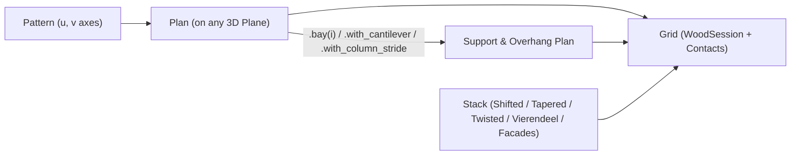

# Grid {#templates_grid}

[TOC]

Planar, facade, and multi-storey timber grid generator: the inputs in `src/templates/grid/grid_guide.h`, the builders `Grid` and `Grids` in `src/templates/grid/grid.h`. The primary unit is a single planar `wood_grid::Plan` embedded on any 3D `Plane`—a single floor, an isolated bay (`Plan::bay`), a sloped roof, or a multi-layer vertical facade (`Plan::facade`)—framed by `wood_grid::Grid` and composed into shifted, tapered, twisted, or hybrid multi-storey buildings by `wood_grid::Stack`.

  <a class="wood-card" href="#grid_example_1">
    
    1 Bay &amp; In-Line Heads
  </a>
  <a class="wood-card" href="#grid_example_2">
    
    2 Floor Footprints
  </a>
  <a class="wood-card" href="#grid_example_3">
    
    3 Facade Grids
  </a>
  <a class="wood-card" href="#grid_example_4">
    
    4 Developed Facade
  </a>
  <a class="wood-card" href="#grid_example_5">
    
    5 Multi-Storey Topologies
  </a>
  <a class="wood-card" href="#grid_example_6">
    
    6 Beam &amp; Grillage Systems
  </a>
  <a class="wood-card" href="#grid_example_7">
    
    7 Structural Slab Systems
  </a>
  <a class="wood-card" href="#grid_assembly_sequence">
    
    Assembly Sequence
  </a>

---

## Code Structure {#grid_architecture}

1. **`Pattern`** generates 2D axis families in local `(u, v)` coordinates: `orthogonal` (including skewed grids and `compute_gradated_bays` shear-gradated spacings), `radial` (concentric glulam rings around an optional oculus), `triangular` (`60°` triaxial grillage), `hexagonal` (`120°` honeycomb), `diagonal` (`45°` half-step shifted square grillage with corner restraint), `concentric` (nested chiral or symmetric inscribed quadrangles), `ramified` (three-way branching tree girders), and `from_lines`.
2. **`Plan`** clips a `Pattern` against optional outer/opening boundary rings and core loops on any 3D `Plane`:
   - Horizontal `Plane` for a **single floor** (`Plan::from_pattern`, `Plan::from_footprint`).
   - Vertical or pitched `Plane` for a **timber facade** or **Vierendeel elevation** (`Plan::facade`, with window openings and gable silhouettes).
   - **Support &amp; overhang modifiers**: `Plan::bay(i)` / `Plan::bays({...})` isolates bays without mesh triangulation diagonals; `Plan::with_cantilever(u, v)` suppresses outer columns to create two- or four-sided cantilevers and single-column umbrellas; `Plan::with_column_stride(su, sv)` places columns on a coarser structural super-grid beneath fine grillages or waffle ribs; and `Plan::perimeter_columns_only()` clears interior columns for long-span halls.
3. **`Framing` &amp; `Grid`** build non-overlapping timber `NodeSupportElement`, `EdgeStraightElement`, `EdgeVariableElement`, `NodeBlockElement`, and `FacePlanarElement` solids with face-to-face contacts:
   - **Systems (`Framing::system`)**: `0` slab (point-supported flat or mushroom CLT slab), `1` posts and beams (`span >= 0` one-way hierarchy, `span = -1` homogeneous grillage, `span = -2` gradated ring/branch hierarchy by family index), `2` girders and flush purlins, `3` stacked purlins / one-way ribs on lowered girders, and `4` two-way coffered **waffle slab** with solid shear drop-panels around columns.
   - **Section-active shaping**: `haunch` deepens girders over standing supports and tapers cantilevered arms (`EdgeVariableElement`); `belly` adds parabolic midspan depth on simple or Gerber suspended spans; `drop_width` / `drop_depth` insert solid square shear drop-panels (`NodeBlockElement`) beneath mushroom slabs or inside waffle rib grids; `foot_scale` tapers hinged portal frame legs from base to rigid knee; and `pinned_feet` seats columns on `NodeSupportElement` base shoes.
   - **Column nodes (`Framing::node`) &amp; T-section carpentry**: `0` flush (columns stop at framing/haunch soffit), `1` through (continuous columns or 3-station vertical-knee tapered frame legs with beams and decks trimmed to column cheeks), and `2` head (**in-line** chamfered polygonal timber head block occupying `[-beam_depth, 0]`, or a flared pyramidal capital beneath a slab or drop-panel).
   - **Multi-storey topologies (`Stack`)**: `from_footprint`, `from_levels` (stepped terraces, shifted cantilevers, umbrella clusters, biaxial Vierendeel space frames, and mega-frame transfer towers), `morph` (`Xform(t)` scaling/twisting towers), and `add_facades`.
4. **Settings**: every design the examples show is a named preset of the guide (`Plan::l_shaped_floor`, `Framing::waffle_coffered_slab`, `Stack::tapered_portal_hall`, `Profiles::built_up`, ...), and **`Grids`** lays a list of `Design`s side by side along `x`, each in its group.

---

## Section-Active Element Library and Engel Taxonomy {#grid_engel_taxonomy}

Following Heino Engel (*Structure Systems / Tragsysteme*, Chapter 3: *Section-Active Structure Systems*), section-active systems resist external loads primarily through **cross-sectional bending moment and shear** ($M, V$) mobilized by axial fiber stress couples across member depth. Wood's seven-element library and joinery interactions map directly onto Engel's four section-active families:

| Wood Element / Mechanism | Geometric Representation | Engel Ch. 3 Section-Active Roles |
|---|---|---|
| **`EdgeStraightElement` + `wood_profile`** | Prismatic extrusion along axis with arbitrary outer/inner section loops (`profile_rectangle`, `profile_w`, `profile_hss`, `profile_t`, `profile_round`) and exact cylindrical BReps (`round_radius > 0`). | **3.1 Beams &amp; Columns**: solid/glulam beams, built-up timber I-joists (`profile_w`), hollow box girders (`profile_hss`), T-ribs (`profile_t`), round timber columns, Vierendeel chords/posts, and homogeneous/skewed/diagonal/concentric grillages. |
| **`EdgeVariableElement`** | Multi-station lofted solid (`sections` along `axis`) with planar side webs, constant top flange datum, and `cuts` bevel planes. | **3.1 Span Optimization &amp; 3.2 Hinged Frames**: parabolic midspan `belly` simple spans, continuous girders with support `haunch` deepening, tapered free cantilevers, articulated **Gerber** cantilever-and-suspended spans, leaning morphed columns, and 3-station **tapered portal frame legs** (`foot_scale < 1`). |
| **`FacePlanarElement`** | Thick planar plate between bottom and top polylines with interior hole loops (`BooleanPolyline` panelization and column notches). | **3.4 Slabs &amp; Core Walls**: one-way and two-way CLT slabs, point-supported flat/mushroom plates, thin top decks over ribbed and waffle floors, flush facade spandrels/cassettes, and pinwheel CLT shear cores. |
| **`NodeBlockElement`** | Lofted polyhedral solid block trimmed by boundary half-planes (`cuts`). | **3.4 Punching-Shear Capitals &amp; Drop Panels**: flared pyramidal under-slab capitals (`head`), 8-sided in-line beam capitals (`inline_head_uv`), and solid square column **drop-panels** (`drop`) under mushroom slabs (`Pilzdecke`) or flush within two-way coffered waffle grids. |
| **`NodeSupportElement`** | Parametric steel-and-pin base connector (`base_plate`, `rod`, `head_plate` as exact BRep cylinders). | **3.2 Hinged Frame Bearings**: pinned base shoes (`pinned_feet = true`) at the narrow feet of two-hinged portal frames and central-column umbrella canopies. |
| **Planar `cuts` &amp; `compute_face_contact`** | Multi-tier angular sector miter solver (`sector_miter_ccw`), girder/drop-panel face clipping (`split_outside_cores_uv`), and face-to-face contact graph (`WoodSession::graph`). | **Continuity &amp; Load-Transmission Hierarchy**: continuous primary girders with T-butted secondary beams/purlins (`span >= 0`), gradated ring/branch hierarchies (`span = -2`), symmetric 3-/4-/6-way grillage miters (`span = -1`), and waffle ribs butted flush to solid column drop-panels. |

### Mapping Engel's Beam, Grillage and Slab Sub-Chapters in `wood_grid`

1. **Beam Structures (Engel §3.1, pp. 177–185)**:
   - *Cross-section efficiency*: `Profiles::built_up()` pairs glulam girders with `profile_w` I-beam purlins and `profile_hss` hollow box edge beams (`Framing::built_up_profiles`).
   - *Multi-span moment shaping &amp; Gerber step-hinges*: `Framing::belly_beams()` matches the positive parabolic moment of five discontinuous simple spans; `Framing::haunched_cantilever()` deepens negative-moment zones over inset columns while tapering balanced end overhangs (`0.35 L`); `Plan::gerber_hall()` + `Framing::gerber_hall()` (`gerber_lap = 260 mm`) models Engel's five-span articulated **Gerber** hall where anchor cantilevers carry two parabolic drop-in spans on four sloped dapped-end half-lap hinges (`Gerbergelenke`); `Pattern::zigzag()` couples inclined beams in herringbone V-chains across both edges and a spine (`Framing::zigzag_floor`); and `Pattern::ramified()` branches six perimeter trunks at three-way Y-forks around an open central hexagonal ring (`Framing::ramified_floor`).
2. **Beam Grids / Grillages (Engel §3.3, pp. 200–205)**:
   - *Commensurate diagonal &amp; four-fold concentric grillages*: besides `orthogonal`, `skewed`, `triangular`, and `hexagonal`, `Pattern::diagonal` snaps integer module counts (`nu, nv`) along `u` and `v` so `+45°` and `-45°` beams meet at **single symmetric K-nodes on all four facades** with cantilevered corners (`Framing::diagonal_floor`), while `Pattern::concentric` (`span = -2`) constructs Engel's **four-fold mirror-symmetric gradated concentric beam grid** (`Abgestufter Zentralrost`) on eight flush perimeter columns, stepping down in depth from primary octagonal `45°` corner girders through alternating midspan squares and corner girders to a central `45°` diamond lantern (`Framing::concentric_floor`).
3. **Slab Structures (Engel §3.4, pp. 206–208)**:
   - *One-way, three-sided, T-beam, ribbed, mushroom, waffle &amp; umbrella slabs*: `Framing::one_way_girder_slab` and `Framing::three_sided_slab` (`open_perimeter = true`) cantilever continuous CLT plates over two parallel girders or a three-sided U-beam frame; `Framing::ribbed_cantilever_slab` and `Framing::t_beam_slab` (`profile_t`) expose open-ended cantilevered ribs beneath thin top decks; `Framing::mushroom_drop_slab` stacks flared capitals and square shear drop-panels under a two-way slab; `Framing::waffle_coffered_slab` and `Framing::diagonal_waffle_slab` (`system = 4`) orient solid square or `45°` diamond shear drop-panels flush with orthogonal or diagonal coffered rib grids; and `Stack::umbrella_canopies` steps four single-column cantilevered umbrellas at alternating heights.
   - *(Rigid portal frames, tiered hinged frames, shear-gradated/concentric/stacked Vierendeel frames, and cellular slab box frames `Plattenrahmen` from Engel §§3.2 &amp; 3.4 are modeled in the dedicated @ref templates_frame template.)*

---

<!-- assembly:begin -->
## Assembly Sequence {#grid_assembly_sequence}

Storey by storey, in each the base supports, columns and walls, their heads and shear drop-panels, girders, beams, purlins, braces and decks. Every move is a `ModuleSequence` move: the module taken apart piece by piece, each piece swept as a solid against every piece still in, the moving ones drawn brown, a GIF per kind of module and one of the whole.

| assembly | | |
|---|---|---|
| **Bay framing**, 113 elements, 105 moves | | |
|  beam head, 19 pieces |  floor l plan, 31 pieces |  isolated bay, 9 pieces |
|  node flush, 13 pieces |  node through, 10 pieces |  purlin stacked, 10 pieces |
|  round columns, 11 pieces |  slab head, 10 pieces |  |
| **Footprints**, 457 elements, 450 moves | | |
|  courtyard, 70 pieces |  hexagonal, 49 pieces |  irregular, 53 pieces |
|  orthogonal, 51 pieces |  radial, 96 pieces |  skewed, 75 pieces |
|  triangular, 63 pieces |  |  |
| **Facades**, 224 elements, 220 moves | | |
|  braced facade, 49 pieces |  curtain mullion, 31 pieces |  gable facade, 66 pieces |
|  punched openings, 78 pieces |  |  |
| **Multi-storey**, 4101 elements, 4093 moves | | |
|  core and facade, 504 pieces |  cylindrical rotunda, 640 pieces |  five bay, 84 pieces |
|  oblique flatiron, 424 pieces |  setback tower, 948 pieces |  shifted floors, 666 pieces |
|  tapered tower, 429 pieces |  twisted tower, 406 pieces |  |
| **Beam and grillage systems**, 361 elements, 353 moves | | |
|  belly spans, 38 pieces |  built up profiles, 17 pieces |  concentric lantern, 60 pieces |
|  diagonal grillage, 100 pieces |  gerber hall, 48 pieces |  haunched cantilever, 43 pieces |
|  ramified floor, 28 pieces |  zigzag floor, 27 pieces |  |
| **Structural slab systems**, 998 elements, 990 moves | | |
|  diagonal waffle slab, 396 pieces |  mushroom drop slab, 51 pieces |  one way girder slab, 25 pieces |
|  ribbed cantilever slab, 77 pieces |  t beam slab, 68 pieces |  three sided slab, 21 pieces |
|  umbrella canopies, 76 pieces |  waffle coffered slab, 284 pieces |  |

<!-- assembly:end -->

## Examples {#grid_examples}

### 1 Bay Isolation and In-Line Column Heads {#grid_example_1}

Isolates bay `0` from a five-bay L-shaped floor plan via `Plan::bay(0)`, then compares pure-timber framing and node details—including **in-line** chamfered timber column heads (`node = 2` sitting in `[-beam_depth, 0]` between square-ended beams), under-slab chamfered heads, flush girders and purlins, continuous through-columns, stacked purlins, and round timber columns.

  <a class="wood-card" href="templates_grid_1_bay_framing_floor_l_plan.webp">
    
    L-Plan Floor
  </a>
  <a class="wood-card" href="templates_grid_1_bay_framing_isolated_bay.webp">
    
    Isolated Bay (bay(0))
  </a>
  <a class="wood-card" href="templates_grid_1_bay_framing_slab_head.webp">
    
    Slab + Chamfered Head
  </a>
  <a class="wood-card" href="templates_grid_1_bay_framing_beam_head.webp">
    
    In-Line Column Heads
  </a>
  <a class="wood-card" href="templates_grid_1_bay_framing_node_flush.webp">
    
    Flush Node &amp; Purlins
  </a>
  <a class="wood-card" href="templates_grid_1_bay_framing_node_through.webp">
    
    Through-Columns
  </a>
  <a class="wood-card" href="templates_grid_1_bay_framing_purlin_stacked.webp">
    
    Stacked Purlins
  </a>
  <a class="wood-card" href="templates_grid_1_bay_framing_round_columns.webp">
    
    Round Timber Columns
  </a>

\include{lineno} templates_grid_1_bay_framing.cpp

---

### 2 Planar Floor Patterns and Footprints {#grid_example_2}

Frames single-floor footprints across seven planar grid patterns: orthogonal L-floor, `30°` skewed parallelogram with `60°`-beveled girder ends coplanar with the skewed perimeter, `12`-sector concentric glulam ring pavilion, equilateral `60°` triangular diagrid, `120°` hexagonal honeycomb with symmetric three-way Y-miters at every node, five-sided irregular polygon, and a courtyard floor plate.

  <a class="wood-card" href="templates_grid_2_footprints_orthogonal.webp">
    
    Orthogonal
  </a>
  <a class="wood-card" href="templates_grid_2_footprints_skewed.webp">
    
    Skewed (30°)
  </a>
  <a class="wood-card" href="templates_grid_2_footprints_radial.webp">
    
    Radial Ring
  </a>
  <a class="wood-card" href="templates_grid_2_footprints_triangular.webp">
    
    Triangular (60°)
  </a>
  <a class="wood-card" href="templates_grid_2_footprints_hexagonal.webp">
    
    Hexagonal (120°)
  </a>
  <a class="wood-card" href="templates_grid_2_footprints_irregular.webp">
    
    Irregular
  </a>
  <a class="wood-card" href="templates_grid_2_footprints_courtyard.webp">
    
    Courtyard
  </a>

\include{lineno} templates_grid_2_footprints.cpp

---

### 3 Timber Facade Grids {#grid_example_3}

Uses `Plan::facade` (`height = 0.0`) to frame vertical timber curtain walls, punched window/spandrel facades (`deck_flush = true`), co-planar X-braced heavy-timber frames (`brace = 2`), and pitched pentagonal gable walls (`brace = 3`).

  <a class="wood-card" href="templates_grid_3_facades_curtain_mullion.webp">
    
    Mullion &amp; Transom
  </a>
  <a class="wood-card" href="templates_grid_3_facades_punched_openings.webp">
    
    Punched Openings
  </a>
  <a class="wood-card" href="templates_grid_3_facades_braced_facade.webp">
    
    X-Braced Facade
  </a>
  <a class="wood-card" href="templates_grid_3_facades_gable_facade.webp">
    
    Gable Facade
  </a>

\include{lineno} templates_grid_3_facades.cpp

---

### 4 Developed Timber Facade (Stammhaus Progression) {#grid_example_4}

Develops a five-storey timber headquarters inspired by the Blumer-Lehmann Stammhaus in Gossau: **(1)** primary glulam structure with an eight-bay recessed ground colonnade, four cantilevered upper CLT slabs, and a projecting flat timber roof cornice; **(2)** recessed ground storefront glazing and upper ribbon window mullions; **(3)** the isolated two-layer developed timber screen (`Framing::fin_screen`, `system = 3` on `Plan::facade`) pairing `760 mm` solid horizontal timber spandrel fascia bands in the inner layer with continuous syncopated vertical glulam fins (`{950, 680, 1240, 880, 750} mm` rhythm) standing proud in the outer layer; and **(4–6)** isometric, front-elevation, and corner-detail views of the complete headquarters.

  <a class="wood-card" href="templates_grid_4_developed_facade_stage_1_colonnade.webp">
    
    1 Colonnade &amp; Slabs
  </a>
  <a class="wood-card" href="templates_grid_4_developed_facade_stage_2_spandrels.webp">
    
    2 Window Envelope
  </a>
  <a class="wood-card" href="templates_grid_4_developed_facade_stage_3_fin_screen.webp">
    
    3 Two-Layer Fin Screen
  </a>
  <a class="wood-card" href="templates_grid_4_developed_facade_stammhaus_headquarters.webp">
    
    4 Complete Headquarters
  </a>
  <a class="wood-card" href="templates_grid_4_developed_facade_stammhaus_elevation.webp">
    
    5 Front Elevation
  </a>
  <a class="wood-card" href="templates_grid_4_developed_facade_stammhaus_detail.webp">
    
    6 Corner Tectonic Detail
  </a>

\include{lineno} templates_grid_4_developed_facade.cpp

---

### 5 Multi-Storey Building Topologies {#grid_example_5}

Eight multi-storey timber building topologies composed via `Stack`: a two-storey L-frame with **in-line** chamfered column heads and 45°-notched flush CLT cassette decks (`five_bay`), five storeys of **shifted** cantilevered floor boxes over a plumb column grid (`Stack::from_levels`), a six-storey **tapered** tower with seamless continuous leaning columns (`Stack::morph`), a seven-storey `42°` **twisting** tower with seamless helicoidal round timber columns (`Stack::morph`), a six-storey cascading **stepped-terrace** building around an open central atrium (`Stack::from_levels`), a four-storey 16-sector **cylindrical** ring-and-radial rotunda (`Pattern::radial`), a four-storey chamfered pentagonal **flatiron** building with `45°` diagonal facade cuts, and a three-storey **core-and-braced** hybrid frame (`Stack::add_facades`).

  <a class="wood-card" href="templates_grid_5_multistorey_five_bay.webp">
    
    Five-Bay (In-Line Heads)
  </a>
  <a class="wood-card" href="templates_grid_5_multistorey_shifted_floors.webp">
    
    Shifted Cantilevers
  </a>
  <a class="wood-card" href="templates_grid_5_multistorey_tapered_tower.webp">
    
    Tapered Tower
  </a>
  <a class="wood-card" href="templates_grid_5_multistorey_twisted_tower.webp">
    
    Twisted Tower (42°)
  </a>
  <a class="wood-card" href="templates_grid_5_multistorey_setback_tower.webp">
    
    Stepped Atrium
  </a>
  <a class="wood-card" href="templates_grid_5_multistorey_cylindrical_rotunda.webp">
    
    Cylindrical Rotunda
  </a>
  <a class="wood-card" href="templates_grid_5_multistorey_oblique_flatiron.webp">
    
    Oblique Flatiron
  </a>
  <a class="wood-card" href="templates_grid_5_multistorey_core_and_facade.webp">
    
    Core &amp; Braced Facades
  </a>

\include{lineno} templates_grid_5_multistorey.cpp

---

### 6 Section-Active Beam and Grillage Systems {#grid_example_6}

Eight beam and grillage systems after Heino Engel (*Structure Systems*, §§3.1 &amp; 3.3): **(1)** built-up timber I-beam purlins (`profile_w`) and hollow box edge beams (`profile_hss`) on glulam girders; **(2)** five simple spans with parabolic midspan `belly` depth increase under stacked purlins; **(3)** continuous multi-span girders with support `haunch` deepening over inset columns and tapered balanced cantilevers; **(4)** a five-span articulated **Gerber** hall whose anchor cantilevers carry two parabolic drop-in spans on four sloped dapped-end half-lap hinges (`gerber_lap = 260 mm`); **(5)** a herringbone skew-coupled **zigzag** beam floor meeting at symmetric V-nodes on both edges and a central spine; **(6)** a commensurate `45°` **diagonal** square grillage with symmetric single-column K-nodes on all four facades and cantilevered corners; **(7)** a four-fold symmetric gradated **concentric** beam grid (`span = -2`) on eight flush perimeter columns; and **(8)** a three-way **ramified** branching tree floor around an open central hexagonal ring on six perimeter round timber columns.

  <a class="wood-card" href="templates_grid_6_beam_grids_built_up_profiles.webp">
    
    Built-Up I &amp; Box
  </a>
  <a class="wood-card" href="templates_grid_6_beam_grids_belly_spans.webp">
    
    Parabolic Belly Spans
  </a>
  <a class="wood-card" href="templates_grid_6_beam_grids_haunched_cantilever.webp">
    
    Haunched Cantilever
  </a>
  <a class="wood-card" href="templates_grid_6_beam_grids_gerber_hall.webp">
    
    Articulated Gerber
  </a>
  <a class="wood-card" href="templates_grid_6_beam_grids_zigzag_floor.webp">
    
    Herringbone Zigzag
  </a>
  <a class="wood-card" href="templates_grid_6_beam_grids_diagonal_grillage.webp">
    
    Diagonal Grillage (45°)
  </a>
  <a class="wood-card" href="templates_grid_6_beam_grids_concentric_lantern.webp">
    
    Concentric Grid
  </a>
  <a class="wood-card" href="templates_grid_6_beam_grids_ramified_floor.webp">
    
    Ramified Tree Floor
  </a>

\include{lineno} templates_grid_6_beam_grids.cpp

---

### 7 Section-Active Structural Slab Systems {#grid_example_7}

Eight structural slab systems after Heino Engel (*Structure Systems*, §3.4): **(1)** a four-sided cantilevered **one-way CLT slab** carried on two parallel haunched glulam girders (`open_perimeter = true`); **(2)** a **three-sided** U-beam supported CLT slab with one free cantilevered open edge; **(3)** a one-way closely **ribbed cantilever slab** with exposed cantilevered joist ends beneath a thin top deck; **(4)** an integral **T-beam slab** (`Plattenbalkendecke`, `profile_t`) cantilevering over inset primary girders; **(5)** a cantilevered two-way CLT **mushroom slab** (`Pilzdecke`) on inset columns with flared capitals and square shear drop-panels; **(6)** an orthogonal two-way coffered **waffle slab** (`system = 4`) on four inset columns with solid square shear drop-panels; **(7)** a `45°` **diagonal coffered waffle slab** (`system = 4, span = -1`) with diamond shear drop-panels aligned squarely with the diagonal ribs; and **(8)** four staggered single-column cantilevered **umbrella canopies** on `NodeSupportElement` base shoes, tapered shafts, and chamfered capitals.

  <a class="wood-card" href="templates_grid_7_slabs_one_way_girder_slab.webp">
    
    One-Way Girder Slab
  </a>
  <a class="wood-card" href="templates_grid_7_slabs_three_sided_slab.webp">
    
    Three-Sided Slab
  </a>
  <a class="wood-card" href="templates_grid_7_slabs_ribbed_cantilever_slab.webp">
    
    Ribbed Cantilever Slab
  </a>
  <a class="wood-card" href="templates_grid_7_slabs_t_beam_slab.webp">
    
    T-Beam Ribbed Slab
  </a>
  <a class="wood-card" href="templates_grid_7_slabs_mushroom_drop_slab.webp">
    
    Mushroom Drop Slab
  </a>
  <a class="wood-card" href="templates_grid_7_slabs_waffle_coffered_slab.webp">
    
    Orthogonal Waffle Slab
  </a>
  <a class="wood-card" href="templates_grid_7_slabs_diagonal_waffle_slab.webp">
    
    Diagonal Waffle Slab
  </a>
  <a class="wood-card" href="templates_grid_7_slabs_umbrella_canopies.webp">
    
    Umbrella Canopies
  </a>

\include{lineno} templates_grid_7_slabs.cpp
