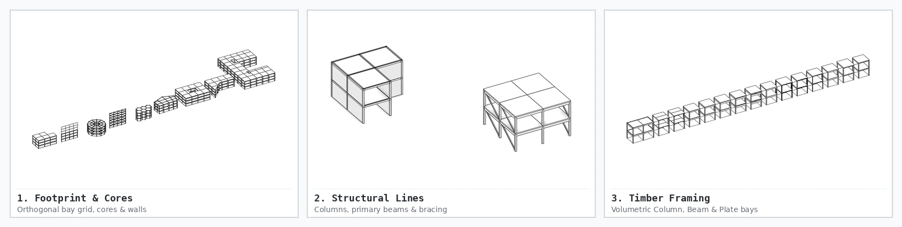

# Multistorey Timber Grid (wood_grid::Grid) {#templates_grid}



`wood_grid::Grid` generates a multistorey post-and-beam timber building from three inputs: a 2D plan `Pattern`, vertical `Building` storeys, and member `Framing` cross-sections. Calling `Grid(pattern, building, framing, session)` populates `WoodSession` with level plan polylines, columns, perimeter and core walls, column heads, drop panels, girders, secondary beams, bay purlins, floor decks, diagonal braces, and planar face-to-face `Joint` contacts.

| Stage | Method / Output | Role |
| :--- | :--- | :--- |
| **1. Level Plans** | `add_plans` → `plans` | Offsets the 2D bay polygons and column points to every storey elevation (`0 .. n_storeys`). |
| **2. Columns & Walls** | `columns_<s>`, `walls_<s>`, `core_walls_<s>` | Extrudes vertical column shafts (`Beam`), perimeter walls (`Plate`), and shear-core walls (`Plate`) for each storey `s`. |
| **3. Heads & Drop Panels** | `heads_<s>`, `drop_panels_<s>` | Places flared `ColumnHead` capitals (`Pyramid`) and `DropPanel` plates at each column top, or shortens column shafts under continuous girders. |
| **4. Girders, Beams & Purlins** | `girders_<s>`, `beams_<s>`, `purlins_<s>` | Spans primary girders along grid edges, secondary beams across bays, and evenly spaced purlins (`purlin_step`, `purlin_direction`) across each bay. |
| **5. Decks & Braces** | `decks_<s>`, `braces_<s>` | Covers each bay with a structural `Plate` deck and inserts diagonal `Beam` braces (`None`, `Single`, `Cross`, `K`, `V`, `InvertedV`) along braced bays. |
| **6. Face Contacts** | `session.compute_face_contacts(0)` | Detects planar bearing, end-butt, and side-lap `Joint` polygons across the entire building frame. |

---

## Primary Inputs (Pattern, Building, Framing)

| Input Struct | Key Factory Methods & Fields | Description |
| :--- | :--- | :--- |
| **`wood_grid::Pattern`** | `from_grid({dx...}, {dy...})` · `from_footprints({poly...})` · `from_bays({bay...})` · `subdivided(nx, ny)` · `merged({bays})` · `without_bays({bays})` | 2D floor layout holding deduplicated `vertices`, `bay_vertices` index loops, `core_bays`, `void_bays`, `wall_edges`, `brace_edges`, and per-bay `purlin_direction` angles. |
| **`wood_grid::Building`** | `from_Constant(n_storeys, height)` · `from_Storeys({h0, h1, ...})` · `elevation(s)` | Vertical storey stack defining `storeys` heights and cumulative floor levels from `z = 0` to `total_height()`. |
| **`wood_grid::Framing`** | `column_width`, `column_depth`, `girder_width`, `girder_depth`, `purlin_width`, `purlin_depth`, `purlin_step`, `deck_thickness`, `wall_thickness`, `ColumnHead`, `DropPanel`, `BraceLayout`, `girder_rule` | Cross-section dimensions (`mm`), bay purlin spacing, column-head and drop-panel sizing, brace topology, and girder continuity rules (`PerBay` or `Continuous`). |

```cpp
#include "wood.h"
#include "templates/grid/grid.h"

using namespace session_cpp;
using namespace wood_grid;

Pattern pattern = Pattern::from_grid({6000.0, 6000.0, 6000.0}, {6000.0, 6000.0});
Building building = Building::from_Constant(3, 3500.0);

Framing framing;
framing.purlin_step = 1500.0;
framing.head = ColumnHead{true, 700.0, 700.0, 350.0, 200.0};

WoodSession session;
Grid grid(pattern, building, framing, session);
```

---

## Step-by-Step Pipeline

### 1. Level Plans (add_plans)

`Grid::add_plans` copies the 2D `Pattern` polygons to every floor elevation `building.elevation(s)` (`s = 0 .. n_storeys`) and stores them under the `plans` tree group so all bays, voids, and column grid intersections can be inspected in 3D.


### 2. Columns (columns_s)

At every vertex of the active bays (excluding vertices belonging only to void bays or core walls), `Grid::add_columns` creates a vertical `Beam` (`column_width × column_depth`) spanning from `elevation(s)` to the underside of the ceiling slab, column head, drop panel, or continuous girder.


### 3. Facade & Core Walls (walls_s, core_walls_s)

Edges listed in `pattern.wall_edges` are extruded as storey-height `Plate` elements (`wall_thickness`) in `walls_<s>`. Bays marked in `pattern.core_bays` have their boundary edges extruded as shear-core walls in `core_walls_<s>`, with doorway openings (`core_door_width × core_door_height`) cut out when configured.


### 4. Column Heads & Drop Panels (heads_s, drop_panels_s)

When `framing.head.enabled` is `true`, `Grid::add_heads` places a flared `Pyramid` capital (`bottom_width → width × depth`) atop each column. When `framing.drop_panel.enabled` is `true`, `Grid::add_drop_panels` inserts a rectangular `Plate` (`width × depth × thickness`) clipped to the building boundary between the column head and the floor slab above.


### 5. Girders, Beams & Bay Purlins (girders_s, beams_s, purlins_s)

`Grid::add_girders` places primary `Beam` members (`girder_width × girder_depth`) along interior and perimeter bay edges, either trimmed column-to-column (`GirderRule::PerBay`) or merged across collinear spans (`GirderRule::Continuous`). `Grid::add_purlins` then populates each bay with secondary ribs (`purlin_width × purlin_depth`) spaced by `framing.purlin_step` along the bay's local `purlin_direction` angle (`0°` or `90°`), trimmed cleanly against the surrounding girders.


### 6. Bay Decks (decks_s)

When `framing.deck_thickness > 0`, `Grid::add_decks` caps each non-void, non-core bay with a horizontal `Plate` (`deck_thickness`) whose top face sits flush with the storey ceiling elevation `elevation(s + 1)`.


### 7. Storey Braces & Global Contacts (braces_s, compute_face_contacts)

Edges marked in `pattern.brace_edges` receive diagonal timber `Beam` braces (`Single`, `Cross`, `K`, `V`, or `InvertedV`) inside the clear window between columns and girders. When `framing.compute_contacts` is enabled, `session.compute_face_contacts(0)` intersects all member faces and records planar `Joint` contacts across the structure.


---

## Complete Examples

### 1. Five-Bay Footprint Topologies (examples/templates_grid_1_footprint.cpp)

Six footprint patterns (`orthogonal`, `irregular`, `radial`, `courtyard`, `l_shape`, `t_shape`) showing how `Pattern::from_bays`, `Pattern::from_grid`, `without_bays`, and `ColumnHead` capitals adapt to orthogonal and non-orthogonal plans:


<details>
<summary>Example code: templates_grid_1_footprint.cpp</summary>

\include{lineno} templates_grid_1_footprint.cpp

</details>

### 2. Solid Massings: Pentagon, Setback Tower, Atrium & Overhang (examples/templates_grid_2_solid.cpp)

Filling closed building massings (`Mesh::from_polylines`, `solid_boolean`) with orthogonal and radial bay patterns, podium-to-tower setbacks, central atrium voids, and cantilevered upper storeys:


<details>
<summary>Example code: templates_grid_2_solid.cpp</summary>

\include{lineno} templates_grid_2_solid.cpp

</details>

### 3. Architectural Line Grids & CREA / Braced Framing (examples/templates_grid_3_lines.cpp)

Constructing multi-storey timber grids directly from architectural line sets (`crea_4x4`) and comparing `CREA` slab-band column-head framing with X-braced post-and-beam bays:


<details>
<summary>Example code: templates_grid_3_lines.cpp</summary>

\include{lineno} templates_grid_3_lines.cpp

</details>

### 4. Reference Structural Systems & Core Configurations (examples/templates_grid_4_reference.cpp)

Comparing reference timber structural systems across footprints, shear cores, storey elevations, and glulam member profiles (`Profiles`, `Framing`):


<details>
<summary>Example code: templates_grid_4_reference.cpp</summary>

\include{lineno} templates_grid_4_reference.cpp

</details>

### 5. Column-to-Slab Systems: Drop Panels, Heads & Continuous Girders (examples/templates_grid_5_framing.cpp)

Comparing flat slab on `DropPanel` capitals, flared `ColumnHead` pyramids with girders, and `GirderRule::Continuous` multi-span girders with two-way purlin grids:


<details>
<summary>Example code: templates_grid_5_framing.cpp</summary>

\include{lineno} templates_grid_5_framing.cpp

</details>
