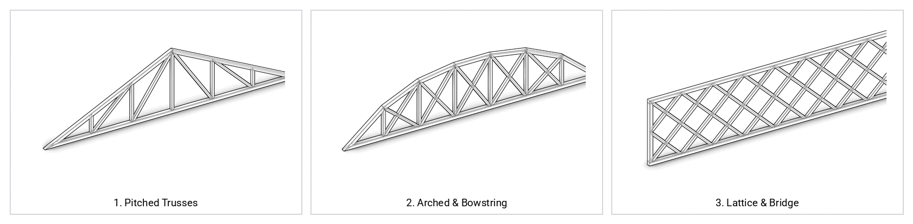

# Parametric Timber Truss (wood_truss::Truss) {#templates_truss}



`wood_truss::Truss` turns a 2D/3D wireframe `TrussGuide` into a cut timber `Element` assembly inside `WoodSession`. It extrudes continuous chord `Beam` profiles, fits web and post `Beam` members, miters chord-to-chord corners, trims web ends flush against chord faces, cuts half-lap cross joints between intersecting diagonals, and records planar face-to-face `Joint` contacts.

| Stage | Method / Output | Role |
| :--- | :--- | :--- |
| **1. Guide Wireframe** | `TrussGuide` (`chords`, `webs`, `posts`) | Defines centerline segments or loads one of the 80 parametric truss presets (`TrussGuide::from_name`). |
| **2. Chords** | `add_chords` → `chord_<i>` | Sweeps top, bottom, and end chord `Beam` solids (`2 * size_chord_w × 2 * size_chord_h`) and miters meeting chord ends along their bisector planes. |
| **3. Webs & Posts** | `add_webs`, `add_posts` → `web_<i>`, `post_<i>` | Creates diagonal and vertical `Beam` solids (`2 * size_web_w × 2 * size_web_h`) extended slightly past the nodes before trimming. |
| **4. Node Butt Cuts** | `trim_webs_against_chords`, `trim_webs_at_nodes` | Clips web and post ends against inner chord faces (`AddPlane`) and bisects adjacent webs that converge at the same node. |
| **5. Cross-Lap Cuts** | `cut_crossing_webs` | Detects intersecting X-web pairs and cuts complementary half-depth lap notches (`JointBeam::cross` + `AddBrep`) into both members. |
| **6. Face Contacts** | `session.compute_face_contacts(0)` | Populates planar `Joint` contact polygons across all mitered chords, butt-trimmed webs, and cross-lapped diagonals. |

---

## Primary Inputs (TrussGuide)

| Parameter / Method | Type / Default | Description |
| :--- | :--- | :--- |
| `chords` | `std::vector<Line>` | Top, bottom, and end-post chord centerlines. |
| `webs` | `std::vector<Line>` | Diagonal web centerlines. |
| `posts` | `std::vector<Line>` | Vertical king/queen post centerlines. |
| `plane` | `Plane` (`XZ` at origin) | Reference plane of the truss (`plane.z_axis()` is the out-of-plane extrusion direction). |
| `size_chord_w`, `size_chord_h` | `double` (`80.0` → `160 × 160 mm`) | Half-width (out-of-plane) and half-height (in-plane) of chord cross-sections. |
| `size_web_w`, `size_web_h` | `double` (`60.0` → `120 × 120 mm`) | Half-width (out-of-plane) and half-height (in-plane) of web and post cross-sections. |
| `TrussGuide::names()` | `80` preset strings | Lists all built-in parametric truss topologies (`truss_pratt_pitched`, `truss_howe`, `truss_warren`, `truss_fink`, `truss_scissors`, `truss_bowstring`, `truss_vierendeel`, etc.). |
| `TrussGuide::from_name(name, l, h, n)` | Factory method | Builds preset `name` with span `l` (`mm`), rise `h` (`mm`), and bay count `n`. |

---

## Code Examples

### 1. Custom Wireframe TrussGuide (Explicit Chords, Webs & Posts)

You can construct a `TrussGuide` directly from custom `Line` lists for `chords`, `webs`, and `posts`, or generate a parametric preset with `TrussGuide::from_name(name, span, height, bays)`:

```cpp
#include "wood.h"
#include "templates/truss/truss.h"

using namespace session_cpp;
using namespace wood_truss;

// Option A: Built-in parametric preset (span = 9000 mm, height = 2250 mm, 6 bays)
TrussGuide pratt = TrussGuide::from_name("truss_pratt_pitched", 9000.0, 2250.0, 6);

// Option B: Custom wireframe lines in the XZ plane
TrussGuide custom(
    {   // chords (bottom tie + two pitched rafters)
        Line(0.0, 0.0, 0.0, 6000.0, 0.0, 0.0),
        Line(0.0, 0.0, 0.0, 3000.0, 0.0, 1500.0),
        Line(3000.0, 0.0, 1500.0, 6000.0, 0.0, 0.0),
    },
    {   // diagonal webs
        Line(1500.0, 0.0, 750.0, 3000.0, 0.0, 0.0),
        Line(4500.0, 0.0, 750.0, 3000.0, 0.0, 0.0),
    },
    {   // vertical king post
        Line(3000.0, 0.0, 0.0, 3000.0, 0.0, 1500.0),
    }
);

WoodSession session;
Truss truss(custom, session);
session.compute_face_contacts(0);
```

### 2. Pratt Roof Truss (examples/templates_truss_1_pratt.cpp)

<details>
<summary>Example code: templates_truss_1_pratt.cpp</summary>

\include{lineno} templates_truss_1_pratt.cpp

</details>

---

## Library (80 Parametric TrussGuide Presets)

All 80 presets returned by `TrussGuide::names()`, generated by `examples/templates_truss_2_library.cpp`:

| | | | |
| :---: | :---: | :---: | :---: |
| <br>`truss_pratt_flat` | <br>`truss_pratt_pitched` | <br>`truss_howe` | <br>`truss_howe_pitched` |
| <br>`truss_warren` | <br>`truss_warren_verticals` | <br>`truss_warren_pitched` | <br>`truss_fink` |
| <br>`truss_double_fink` | <br>`truss_fan` | <br>`truss_modified_fan` | <br>`truss_king_post` |
| <br>`truss_queen_post` | <br>`truss_scissors` | <br>`truss_raised_tie` | <br>`truss_collar_tie` |
| <br>`truss_hammerbeam` | <br>`truss_cambered_fink` | <br>`truss_double_howe` | <br>`truss_double_pitch_4` |
| <br>`truss_double_pitch_6` | <br>`truss_Polonceau` | <br>`truss_mono_pratt` | <br>`truss_mono_howe` |
| <br>`truss_mono_fink` | <br>`truss_mono_fan` | <br>`truss_sawtooth` | <br>`truss_north_light` |
| <br>`truss_monitor` | <br>`truss_clerestory` | <br>`truss_mansard` | <br>`truss_gambrel` |
| <br>`truss_attic` | <br>`truss_studio` | <br>`truss_hip` | <br>`truss_flat_howe` |
| <br>`truss_flat_double_warren` | <br>`truss_flat_k` | <br>`truss_flat_baltimore` | <br>`truss_flat_sub_pratt` |
| <br>`truss_vierendeel` | <br>`truss_flat_cantilever` | <br>`truss_flat_sloped_ends` | <br>`truss_flat_town_lattice` |
| <br>`truss_bowstring` | <br>`truss_bowstring_howe` | <br>`truss_bowstring_warren` | <br>`truss_lenticular` |
| <br>`truss_parker` | <br>`truss_camelback` | <br>`truss_pennsylvania` | <br>`truss_ crescent` |
| <br>`truss_arch_tied` | <br>`truss_arch_spandrel` | <br>`truss_pegram` | <br>`truss_burr_arch` |
| <br>`truss_belgian` | <br>`truss_english` | <br>`truss_fink_inverted` | <br>`truss_warren_inverted` |
| <br>`truss_brown` | <br>`truss_whipple` | <br>`truss_post` | <br>`truss_stearns` |
| <br>`truss_k_pitched` | <br>`truss_queen_fan` | <br>`truss_scissors_mod` | <br>`truss_polonceau_cambered` |
| <br>`truss_pitched_crossed_posts` | <br>`truss_flat_crossed_warren` | <br>`truss_bowstring_crossed` | <br>`truss_scissors_crossed` |
| <br>`truss_portal_frame` | <br>`truss_three_hinged_arch` | <br>`truss_butterfly` | <br>`truss_boomerang` |
| <br>`truss_space_planar` | <br>`truss_pagoda` | <br>`truss_bicycle_wheel` | <br>`truss_asymmetric_fink` |

<details>
<summary>Example code: templates_truss_2_library.cpp</summary>

\include{lineno} templates_truss_2_library.cpp

</details>
